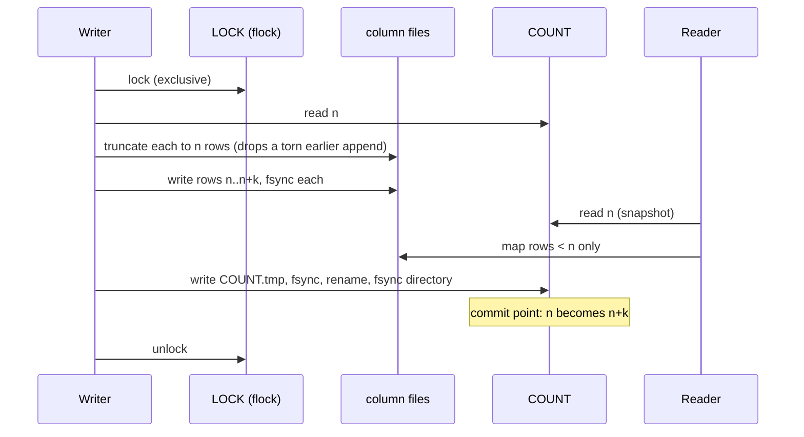
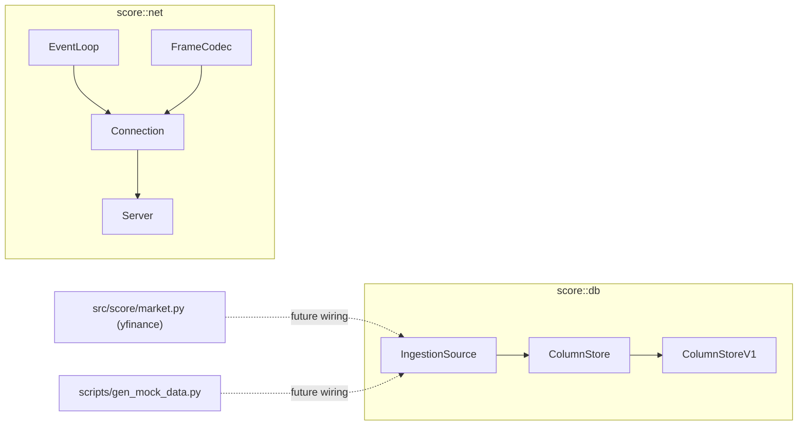
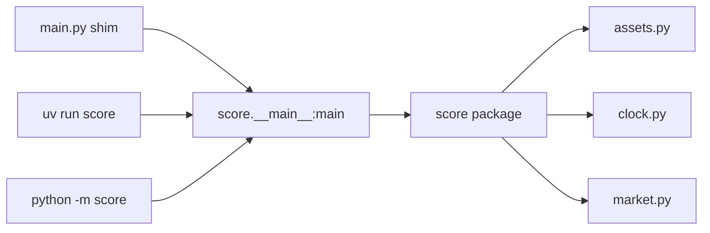
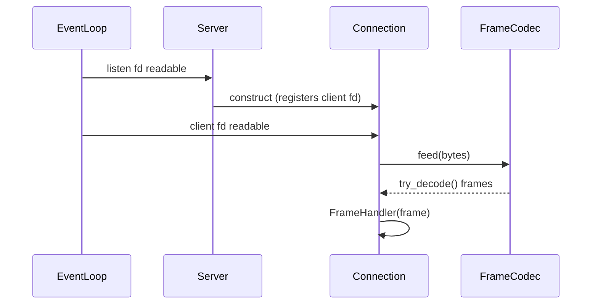

# Changelog

### 2026-11-16 — Merged formatter into database_interface

Merged the `formatter` branch into `database_interface`, keeping both the parametric and the historical VaR/CVaR implementations.

Technical summary

**Motivation.** `formatter` (column store, networking module, clang-format/yapf pass, historical VaR/CVaR) and `database_interface` (parametric VaR/CVaR, normal quantile, VaR backtest) diverged from `0ec9731` and both edited the risk and binding files, giving 8 content conflicts.

**Approach.** Every conflict was an independent addition on each side, so each was resolved as a union, in `formatter`'s formatting style. No behavior from either branch was dropped.

| File | Resolution |
| --- | --- |
| [include/score/statistics/cdf.hpp](include/score/statistics/cdf.hpp) | Kept `std_math::quantile` declaration |
| [src/statistics/cdf.cpp](src/statistics/cdf.cpp) | Kept `std_math::quantile` bisection |
| [include/score/statistics/risk.hpp](include/score/statistics/risk.hpp) | Declares `calculate_var`/`calculate_cvar` and `historical_var`/`historical_cvar` |
| [src/statistics/risk.cpp](src/statistics/risk.cpp) | Both implementations; includes `cdf.hpp` and `normal_pdf.hpp` added to the sorted include block |
| [src/bindings/nanobindings.cpp](src/bindings/nanobindings.cpp) | Binds `calculate_var`/`calculate_cvar` alongside `Bar` and `ColumnStoreV1` |
| [python/score/_core.py](python/score/_core.py) | Imports the union of both export lists |
| [python/score/__init__.py](python/score/__init__.py) | Re-exports the union of both export lists |
| [tests/python/test_bindings.py](tests/python/test_bindings.py) | Kept the VaR/CVaR test and the `Bar`/`ColumnStoreV1` tests |

**Verification.** `make test`: ctest 31/31 passed; pytest 30 passed, 1 skipped (`test_pg_oracle.py`, `psycopg` not installed).

### 2026-11-14 — Stubbed the from-scratch column store (format, commit marker, mmap reads, file locks) with hidden tests and study notes

Replaced the placeholder `ColumnStoreV1` row-file code with compiling stubs for the agreed v1 design, added 63 hidden tests that define its behavior, 9 enabled VaR/CVaR tests, Python bindings for `Bar` and `ColumnStoreV1`, and a per-phase snippets and reading file. No storage logic is implemented: the function bodies are left to be written by hand.

Technical summary

**Motivation.** The database work in this repo is a learning project. Two planning sessions settled the design (recorded as decisions 1-17 in [tasks/todo.md](tasks/todo.md)): build the engine from scratch, daily bars first, Postgres only as correctness oracle and benchmark baseline. The earlier `ColumnStoreV1` wrote one row file per symbol with a string date in every row, had an empty `scan()`, and a `count()` that divided the file size by 44 although a row was 54 bytes. This pass replaces it with scaffolding for the chosen design, so that each function can be written and tested in isolation.

**Design being scaffolded.** One directory per symbol, one fixed-width little-endian file per column, and a committed row count that makes an append atomic.

Row $r$ of a column with value width $w$ lives at byte offset

$$\text{offset}(r) = 16 + r \cdot w, \qquad w = 4 \text{ (date, int32 days since 1970-01-01)}, \; w = 8 \text{ (prices, volume)}$$

The 16-byte header keeps values 8-byte aligned in a memory mapping. At the design scale of $5000 \times 7560 \approx 3.8 \times 10^7$ bars, a bar costs $4 + 5 \cdot 8 = 44$ bytes, about 1.7 GB in total.

A reader that snapshots `COUNT` before the rename sees none of the append; one that reads it after sees all of it. Rows past `COUNT` are never read, so a crashed append needs no separate recovery step.

**Approach.**
- Every stub has its full signature, a contract in the header, numbered `TODO(xx)` steps in the source file, and throws `score::NotImplementedError`. `UniqueFd` and the `ColumnView` move operations are provided complete.
- Storage tests carry the Catch2 tag `[.todo]`, which hides them from `ctest`. Removing the tag enables a test. Validation failures are asserted as `score::DomainError` and system-call failures as `std::system_error`, so a stub's `NotImplementedError` can never satisfy an assertion.
- Crash tests fake a torn append by writing extra bytes into column files and leaving a stale `COUNT.tmp`; no failure hooks exist in production code. Multi-process tests use `fork()`.
- Benchmarks are Catch2 `BENCHMARK` cases behind `[!benchmark]`; no new build target.

| File | Change |
|---|---|
| [include/score/db/date_codec.hpp](include/score/db/date_codec.hpp), [src/db/date_codec.cpp](src/db/date_codec.cpp) | New stubs: ISO date <-> int32 day count |
| [include/score/db/column_file.hpp](include/score/db/column_file.hpp), [src/db/column_file.cpp](src/db/column_file.cpp) | New: column file format spec, `ColumnType`, `ColumnHeader`, `UniqueFd` (complete); stubs for header encode/decode, open, `write_rows`/`read_rows`, `is_valid_symbol` |
| [include/score/db/symbol_dir.hpp](include/score/db/symbol_dir.hpp), [src/db/symbol_dir.cpp](src/db/symbol_dir.cpp) | New stubs: `full_fsync`, `fsync_directory`, `read_committed_count`, `commit_count`, `truncate_to_rows`, `SymbolLock` |
| [include/score/db/column_view.hpp](include/score/db/column_view.hpp), [src/db/column_view.cpp](src/db/column_view.cpp) | New: `ColumnView` (memory-mapped column range); `map`, destructor and typed accessors are stubs |
| [include/score/db/column_store.hpp](include/score/db/column_store.hpp) | Added `Column` enum and pure virtual `scan_column` |
| [include/score/db/column_store_v1.hpp](include/score/db/column_store_v1.hpp), [src/db/column_store_v1.cpp](src/db/column_store_v1.cpp) | Layout and guarantees documented; row-file implementation removed; `append`, `scan`, `scan_column`, `symbols`, `count`, `symbol_dir`, `find_rows` are stubs |
| [src/CMakeLists.txt](src/CMakeLists.txt) | Registered the four new `db/*.cpp` sources |
| [tests/cpp/db_test_util.hpp](tests/cpp/db_test_util.hpp) | New: `TempDir`, deterministic test bars, raw file helpers, `run_in_child` |
| [tests/cpp/test_db_date_codec.cpp](tests/cpp/test_db_date_codec.cpp), [test_db_column_file.cpp](tests/cpp/test_db_column_file.cpp), [test_db_symbol_dir.cpp](tests/cpp/test_db_symbol_dir.cpp), [test_db_column_view.cpp](tests/cpp/test_db_column_view.cpp) | New hidden tests for the helpers (6, 13, 9, 10) |
| [tests/cpp/test_db_column_store.cpp](tests/cpp/test_db_column_store.cpp) | Rewritten: 23 hidden tests (append, layout, rejection, torn-append recovery, scan ranges, column views, multi-process) replacing 2 that shared one temp directory |
| [tests/cpp/test_ingestion.cpp](tests/cpp/test_ingestion.cpp) | New: 2 hidden tests with a fake `IngestionSource` |
| [tests/cpp/test_risk.cpp](tests/cpp/test_risk.cpp) | New: 9 enabled tests for `historical_var`/`historical_cvar` |
| [tests/cpp/bench_db.cpp](tests/cpp/bench_db.cpp) | New: ingest, column scan, row scan, cross-section and VaR benchmarks |
| [tests/cpp/CMakeLists.txt](tests/cpp/CMakeLists.txt) | Registered the new test files |
| [src/bindings/nanobindings.cpp](src/bindings/nanobindings.cpp), [python/score/_core.py](python/score/_core.py), [python/score/__init__.py](python/score/__init__.py) | Bound and exported `Bar` and `ColumnStoreV1` (`append`, `scan`, `symbols`, `count`) |
| [tests/python/test_bindings.py](tests/python/test_bindings.py) | Added 2 tests for the new bindings |
| [tests/python/test_pg_oracle.py](tests/python/test_pg_oracle.py) | New: compares `scan()` with Postgres on 200 random ranges; skipped without `psycopg` and `SCORE_PG_DSN` |
| [tasks/code_snippets.md](tasks/code_snippets.md) | Added one section per phase: technique snippet, common mistakes, reading list |
| [tasks/todo.md](tasks/todo.md) | Added the storage engine v1 plan: decisions 1-17, working method, ordered checklist per phase |

**Verification.** `ctest`: 31 of 31 enabled tests pass. `score_tests "[.todo]"`: all 63 hidden tests fail, 60 with `Not implemented: score::db::...` and 3 fork-based ones through a child that hit a stub; none passes by accident. `pytest tests/python`: 23 passed, 1 skipped. The 7 C++ snippets in the notes compile with `clang++ -std=c++23 -Wall -Wextra`. All 18 linked pages returned HTTP 200; the section names cited for the nanobind, file-locking, "Files are hard" and date-algorithm pages were checked against the page text.

**Not verified.** No Postgres server was available: `test_pg_oracle.py` and the SQL in the notes have not been run. The Linux build was not run. Whether nanobind marks a `const double` array read-only in NumPy was not tested; the notes ask for a test of it.

### 2026-10-18 — Added dark-mode deep-dive tutorials (HTML + PDF) under artifacts/ and fixed a wrong VaR comment

Added `artifacts/` with a dark-mode, interactive HTML tutorial and a 65-page dark-mode PDF tutorial. Both cover the networking, storage and VaR/CVaR scaffolding. Also corrected a comment in [risk.cpp](src/statistics/risk.cpp) that named the wrong element of the tail as the VaR quantile.

Technical summary

**Motivation.** The 2026-10-17 scaffolding pass introduced several design ideas at once: reactor-pattern networking, length-prefixed framing, a columnar store and historical VaR/CVaR. This is a learning project, so each idea now has a tutorial. Each one teaches from first principles, works rigorous examples with numbers computed by running code, poses engineering questions (hints only, no answers), and cites academic and historical sources. Both tutorials follow one shared fact sheet, so their numbers and terminology match.

**Comment bug.** The comment above `HistoricalTail` said the index-0 element of the tail is the VaR quantile. The code reads `sorted_returns[tail_index - 1]`, the least extreme return inside the tail. Index 0 is the worst return. The code was right and the comment was wrong. Only the comment changed, so behavior is the same. Both tutorials now pose this as an exercise.

**Open design note, surfaced but not changed.** The repo's estimator returns $-X_{(\lfloor pn \rfloor)}$ with $p = 1 - c$. Inverting the empirical CDF (Hyndman & Fan Type 1) gives $-X_{(\lfloor pn \rfloor + 1)}$. The repo's rule is therefore never less conservative, and it throws at $c = 0.95, n = 10$ where Type 1 would return the sample minimum. Both tutorials discuss the difference.

| File | Change |
|---|---|
| [artifacts/score-deep-dive.html](artifacts/score-deep-dive.html) | New: dark-first interactive tutorial (8 chapters, 6 animated explainers, engineering questions with hints, notes boxes saved in the browser, references). Also published as a Claude artifact. |
| [artifacts/score-deep-dive.pdf](artifacts/score-deep-dive.pdf) | New: 65-page dark-mode tutorial with proofs, exercises, hints appendix, historical case studies and a bibliography |
| [artifacts/pdf-src/](artifacts/pdf-src/) | New: LaTeX, Mermaid, SVG, plot data, verbatim repo snapshots and the `verify/` programs needed to rebuild the PDF |
| [src/statistics/risk.cpp](src/statistics/risk.cpp) | Comment fix only: the VaR quantile is the tail's last element (`tail_index - 1`), not index 0 |
| [tasks/lessons.md](tasks/lessons.md) | New: deep-dive deliverables are tutorials in dark mode, not recaps |

**Verification.** All numbers in both tutorials came from running code. That includes VaR/CVaR from the repo's own `risk.cpp`, an exhaustive epsilon scan (0 mismatches with the `1e-9` guard), the frame bytes from nlohmann `dump()` (a 40-byte payload with prefix `00 00 00 28`), 4,186 decode splits, and the Patriot clock drift (0.3433 s, matching the GAO report). The HTML was loaded in headless Chrome: no console errors and no horizontal scroll at 390px. Every PDF page was rasterized and checked by eye. A clean rebuild gives 65 pages with no undefined references. The PDF's `risk.cpp` snapshot matches the repo.

### 2026-10-17 — Scaffolded a columnar storage module and an async networking module, added historical VaR/CVaR

Added `score::db` (columnar OHLCV storage + ingestion interface) and `score::net` (reactor/codec/server interfaces) as scaffolding for a learning-driven stock database with a hand-rolled networking layer, and extended [risk.hpp](include/score/statistics/risk.hpp) with real historical-simulation VaR/CVaR so "portfolio/trade risk" is actually computable.

Technical summary

**Motivation.** The project had solid risk math (log-returns, Sharpe, max drawdown) but no persistence anywhere — data came from two disconnected, unpersisted paths ([src/score/market.py](src/score/market.py)'s live `yfinance` pulls and [scripts/gen_mock_data.py](scripts/gen_mock_data.py)'s synthetic generator) — and no VaR/CVaR, the metric "trade risk" actually means. There was also no networking/concurrency code anywhere. Settled via an extended grilling session: build a custom columnar store and a hand-rolled async TCP engine as the main learning vehicle (gRPC stays an explicit, separate later phase), with a platform-agnostic `EventLoop` interface so the concurrency-model progression (thread-per-connection &rarr; epoll &rarr; io_uring) builds on both macOS and Linux.

**VaR/CVaR.** `historical_var`/`historical_cvar` in [risk.hpp](include/score/statistics/risk.hpp)/[risk.cpp](src/statistics/risk.cpp) use historical simulation: sort returns ascending, take the empirical loss quantile (VaR) or the mean of the tail beyond it (CVaR), via a shared private `historical_tail` helper. The tail-size calculation needed a small epsilon guard — $1.0 - 0.90 = 0.09999999999999998$ in IEEE-754 double precision, which truncated `tail_index = floor(0.1 \times 10)` to `0` instead of `1` at an exact decile boundary.

$$\text{tail\_index} = \left\lfloor (1 - \text{confidence\_level}) \times n + \varepsilon \right\rfloor, \quad \varepsilon = 10^{-9}$$

**`score::db` and `score::net`.** Pure scaffolding (header interfaces + `.cpp` stub bodies that `throw score::NotImplementedError(...)`, reusing the existing exception hierarchy): `ColumnStore`/`ColumnStoreV1` + `IngestionSource` for storage, and `EventLoop`/`FrameCodec`/`JsonFrameCodec`/`Connection`/`Server` for networking. `db/column_store_v1.cpp` is wired into `score_core` now (platform-independent); `net/*.cpp` is intentionally left out of the build — its Linux-only `epoll` backend needs its own CMake guard, tracked as a separate phase in [tasks/todo.md](tasks/todo.md). The full phased roadmap (concurrency progression, binary wire-protocol refactor, tests, nanobind exposure, gRPC facade) is also now tracked on the generated board via a new `scripts/roadmap_boards.json` entry.

| File | Change |
|---|---|
| [include/score/statistics/risk.hpp](include/score/statistics/risk.hpp), [src/statistics/risk.cpp](src/statistics/risk.cpp) | Added `historical_var`/`historical_cvar` (real implementation, historical simulation) |
| [include/score/db/bar.hpp](include/score/db/bar.hpp), [column_store.hpp](include/score/db/column_store.hpp), [column_store_v1.hpp](include/score/db/column_store_v1.hpp), [ingestion.hpp](include/score/db/ingestion.hpp) | New: `Bar`, `ColumnStore`, `ColumnStoreV1`, `IngestionSource` interfaces |
| [src/db/column_store_v1.cpp](src/db/column_store_v1.cpp) | New: `ColumnStoreV1` stub bodies (`NotImplementedError`) |
| [include/score/net/event_loop.hpp](include/score/net/event_loop.hpp), [codec.hpp](include/score/net/codec.hpp), [json_codec.hpp](include/score/net/json_codec.hpp), [connection.hpp](include/score/net/connection.hpp), [server.hpp](include/score/net/server.hpp) | New: `EventLoop`, `FrameCodec`, `JsonFrameCodec`, `Connection`, `Server` interfaces |
| [src/net/json_codec.cpp](src/net/json_codec.cpp), [connection.cpp](src/net/connection.cpp), [server.cpp](src/net/server.cpp) | New: stub bodies (`NotImplementedError`), not yet wired into CMake |
| [src/CMakeLists.txt](src/CMakeLists.txt) | Added `db/column_store_v1.cpp` to `SCORE_CORE_CPP_SOURCES` |
| [tasks/todo.md](tasks/todo.md) | Appended the full 12-phase roadmap (Phases 0-3 done this pass) |
| [scripts/roadmap_boards.json](scripts/roadmap_boards.json), [scripts/gen_roadmap.py](scripts/gen_roadmap.py), [roadmap/ROADMAP.excalidraw](roadmap/ROADMAP.excalidraw) | Added "Data Engineering"/"Networking Engineering" columns + VaR scaffold node; added `teal`/`pink` to the color palette; regenerated the board |

**Verification.** `make test-cpp` (16/16 passed) and `make test-py` (21/21 passed), no regressions. New `net/` headers/sources syntax-checked standalone (not yet in any build target). `historical_var`/`historical_cvar` spot-checked against hand-computed quantiles on a 10-point returns series (including the exact-boundary case that caught the epsilon bug above). `python scripts/gen_roadmap.py --selftest` then a full regenerate confirmed the new board entries are structurally valid. `git diff --stat` matches the plan's blast radius.

### 2026-10-17 — Switched to Google C++ style and added a matching Python formatter

Replaced the hand-tuned `.clang-format` with the Google C++ Style Guide config, and gave Python an equivalent knob-configured formatting pipeline (`isort` + `yapf`) wired into `make format`.

Technical summary

**Motivation.** The repo wanted its C++ formatting to follow the standard Google C++ Style Guide clang-format config instead of the previous hand-tuned LLVM-based one, and wanted Python formatted with the same philosophy — explicit, knob-level configuration rather than an opinionated fixed style.

**C++23 standard note.** `clang-format`'s `Standard` enum has no `c++23` literal (it tops out at `c++20`, then `Latest` for anything newer) — the previous `.clang-format` already said `Standard: c++23`, which `clang-format` has never accepted. Fixed by using `Standard: Latest`, which is `clang-format`'s mechanism for C++23-and-beyond.

**Python formatter choice.** `yapf` is the only mainstream Python formatter with a clang-format-style knob surface (`based_on_style`, `column_limit`, `indent_width`, `spaces_before_comment`, `split_before_logical_operator`, …) including a built-in `google` base style — Black/ruff-format are intentionally non-configurable and can't mimic a tuned clang-format config. `isort` was added alongside it as the Python analogue of clang-format's `IncludeBlocks`/`SortIncludes`.

**Incidental fix.** `src/score/market.py` had a stray `def low(self):xp` typo (leftover `xp` after the colon) that made the file a syntax error, which blocked `yapf` from running. Removed the typo; behavior is unchanged (`low()` already correctly returned `self._daily["Low"].iloc[0]` on the next line).

| File | Change |
|---|---|
| [.clang-format](.clang-format) | Replaced with the Google C++ Style Guide config; `Standard: Latest` (see note above) |
| [pyproject.toml](pyproject.toml) | Added `[tool.yapf]` and `[tool.isort]`; added `yapf`/`isort` to `dev` deps |
| [Makefile](Makefile) | Split `format` into `format-cpp` + `format-py`; `make format` runs both |
| [src/score/market.py](src/score/market.py) | Fixed stray `xp` typo that broke parsing |
| All `.hpp`/`.cpp` under `include/`, `src/`, `tests/cpp/` | Reformatted to the new Google style (mechanical only) |
| All `.py` under `src/score/`, `python/`, `scripts/`, `tests/python/` | Reformatted with `isort` + `yapf` (mechanical only) |

**Verification.** `make format` runs end-to-end with no errors. `make test-cpp` (16/16 passed) and `make test-py` (21/21 passed) both pass after reformatting, confirming no behavior change.

### 2026-10-04 — Fixed clangd errors and moved the build to C++23

Added a `.clangd` config so the IDE resolves `score/...` includes and uses the real build flags, clearing the spurious linter errors in `cdf.cpp` and `descriptive.cpp`.

Technical summary

**Root cause.** With no `build/compile_commands.json` (and no `.clangd`), clangd parsed each file with default flags: no `-I include` and a pre-C++17 standard. Includes like `score/statistics/cdf.hpp` failed to resolve, and `DescriptiveStats`, `Series` and `normal_pdf` errors cascaded from that. Both files compile cleanly with the real flags.

**Fix.** `CMAKE_EXPORT_COMPILE_COMMANDS` was already on; the project was just never configured. Configured `build/` (gitignored) and added `.clangd` pointing `CompilationDatabase` at it. `clangd --check` reports 0 errors on both files.

| File | Change |
|---|---|
| [.clangd](.clangd) | Added; selects `build/` as the compilation database |
| [CMakeLists.txt](CMakeLists.txt) | Root standard set to C++23 |
| [src/CMakeLists.txt](src/CMakeLists.txt) | `score_core` target pin 17 -> 23 |
| [src/bindings/CMakeLists.txt](src/bindings/CMakeLists.txt) | Bindings target pin 17 -> 23 |
| [tests/cpp/CMakeLists.txt](tests/cpp/CMakeLists.txt) | Test target pin 17 -> 23 |
| [.clang-format](.clang-format) | `Standard: c++23` |
| [README.md](README.md), [docs/architecture.md](docs/architecture.md), [docs/building.md](docs/building.md) | Updated C++ standard and minimum compiler versions |
| [CHANGELOG.md](CHANGELOG.md) | Added this entry |

**C++23 switch.** The root setting was overridden by per-target `CXX_STANDARD 17` pins, so the build still used `-std=c++17`. All pins now say 23; every compile command uses `-std=c++23`. The minimum compilers in `docs/building.md` were updated by estimate (Apple Clang 16+, Clang 17+, GCC 13+), not tested.

**Verification.** Full rebuild with no warnings; `ctest` passed 12/12.

### 2026-09-08 — Moved numeric primitives into the C++ core

Replaced the private C17 kernel layer with C++17 statistics operations and documented nanobind as the primary Python interface.

Technical summary

**Motivation.** The C kernel files were private implementation details used only by `DescriptiveStats`; maintaining a separate C language and build configuration did not provide an ABI benefit. The C API remains useful for non-Python FFI clients, but is correctly implemented by C++ `extern "C"` wrappers.

**Approach.** `DescriptiveStats` now uses `std::accumulate`, `std::min_element`, and `std::max_element` directly. The CMake project builds C++ only, nanobind continues to bind the C++ domain types directly, and the documentation presents the C ABI as an optional peer integration surface.

| File | Change |
|---|---|
| [src/statistics/descriptive.cpp](src/statistics/descriptive.cpp) | Replaced C-kernel calls with C++ standard algorithms and local moment calculations |
| [src/c_kernels/kernels.c](src/c_kernels/kernels.c) | Deleted private C17 numeric implementation |
| [include/score/c_kernels/kernels.h](include/score/c_kernels/kernels.h) | Deleted private C-kernel declarations |
| [tests/cpp/test_kernels.cpp](tests/cpp/test_kernels.cpp) | Deleted tests for removed private implementation detail |
| [CMakeLists.txt](CMakeLists.txt) | Removed C language and C17 configuration |
| [src/CMakeLists.txt](src/CMakeLists.txt) | Removed C-kernel source and target C standard properties |
| [tests/cpp/CMakeLists.txt](tests/cpp/CMakeLists.txt) | Removed deleted kernel test source |
| [README.md](README.md) | Rewrote project overview around C++ core, nanobind, and optional C ABI |
| [docs/architecture.md](docs/architecture.md) | Replaced the C17 layer with the optional C ABI |
| [docs/building.md](docs/building.md) | Updated compiler and core-language terminology |
| [pyproject.toml](pyproject.toml) | Updated package description and classifiers for a C++ implementation |
| [tasks/todo.md](tasks/todo.md) | Recorded migration plan and validation |
| [tasks/code_snippets.md](tasks/code_snippets.md) | Recorded the central-moment implementation pattern |
| [CHANGELOG.md](CHANGELOG.md) | Added this entry |

**Verification.** A fresh C++-only CMake configure and build succeeded. `score_tests "[stats]"` passed 7 test cases with 8 assertions. After `make dev` installed `nanobind`, the `_score_native` target built successfully and `.venv/bin/python -c "import score"` reported `0.1.0`.

### 2026-07-11 — Added portfolio-optimization roadmap (deep-dive doc + generated Excalidraw board)

Authored a math+OOP roadmap toward portfolio optimization: a LaTeX deep-dive and a regenerable Excalidraw board.

Technical summary

**Motivation.** The user is rebuilding stats/probability/DE skills and wants a portfolio-optimization target that stays in step with the existing `Asset`/`Stock`/`Portfolio` Composite. The prior Excalidraw generator only survived on the `archive` branch (removed in the C++→Python pivot), so the tooling was rebuilt for the pure-Python project.

**Approach.** A declarative JSON spec drives a self-contained generator that emits an Excalidraw board (rounded-rectangle cards, bound text, dependency arrows). The deep-dive doc covers four phases — returns → statistics ($\Sigma$, $\beta$) → probability (VaR/CVaR, Monte Carlo) → Markowitz frontier and SDEs (GBM, OU, Black–Scholes) — each paired with the design pattern that lands it in the codebase (Value Object, Strategy, Visitor).

| File | Change |
|---|---|
| [roadmap/ROADMAP.md](roadmap/ROADMAP.md) | New — LaTeX/Mermaid deep-dive; math track × OOP/pattern track |
| [scripts/roadmap_boards.json](scripts/roadmap_boards.json) | New — declarative board spec (5 columns, 13 cards, 13 edges) |
| [scripts/gen_roadmap.py](scripts/gen_roadmap.py) | New — generator + `--selftest` structural validator |
| [roadmap/ROADMAP.excalidraw](roadmap/ROADMAP.excalidraw) | Generated — do not hand-edit |
| [CHANGELOG.md](CHANGELOG.md) | This entry |

The efficient-frontier objective the roadmap builds toward:

$$\min_{\mathbf{w}} \; \mathbf{w}^\top \Sigma\, \mathbf{w} \quad \text{s.t.} \quad \mathbf{w}^\top \boldsymbol{\mu} = \mu_{\text{target}}, \;\; \mathbf{w}^\top \mathbf{1} = 1.$$

**Verification.** `python scripts/gen_roadmap.py --selftest` → `13 cards, 13 edges, 46 elements`; regen writes valid JSON (re-parsed with `json.load`). Edge endpoints and text containers validated against the spec node set.

### 2026-07-10 — Reorganized into a `src/score` package with a thin runner

Split the monolithic `main.py` into a proper `src/`-layout Python package; `main.py` is now a thin runner.

Technical summary

**Motivation.** After the C++→Python pivot, all classes lived in a single `main.py`. That conflates the *library* (objects) with the *entry point* (runner), and blocks packaging/importing. Moving to a `src/score/` layout separates the two and makes `score` installable and importable.

**Approach.** Classes were grouped into cohesive modules and the package re-exports its public API from `__init__.py`. `main.py` became a shim delegating to the canonical runner `score.__main__:main`, which is also exposed as a console script (`uv run score`) and a module entry point (`python -m score`).

| File | Change |
|---|---|
| [src/score/clock.py](src/score/clock.py) | New — `Clock` time source (injectable) |
| [src/score/market.py](src/score/market.py) | New — `MarketData` yfinance facade with cached fetches |
| [src/score/assets.py](src/score/assets.py) | New — `Asset` / `Stock` / `Portfolio` (Composite pattern) |
| [src/score/__init__.py](src/score/__init__.py) | New — re-exports public API |
| [src/score/__main__.py](src/score/__main__.py) | New — canonical runner (`python -m score`, console script) |
| [main.py](main.py) | Reduced to a shim importing `score.__main__:main` |
| [pyproject.toml](pyproject.toml) | Added hatchling build backend, `src/score` wheel target, `score` console script, `pytest pythonpath=src` |
| [test_main.py](test_main.py) | Import path changed from `main` to `score` |

**Verification.** `uv sync` installs `score` editable; `pytest` 8/8 pass; all three runners (`uv run score`, `python -m score`, `python main.py`) print `My Portfolio: $3,153.30` against the live yfinance API.

### 2026-10-24 — Implemented net codec, connection and server

Implemented the `score::net` stubs: a length-prefixed `JsonFrameCodec`, a POSIX-socket `Connection`, and an accepting `Server`, covered by loopback tests.

Technical summary

**Motivation.** Phase 3 only scaffolded `score::net` with bodies that threw `NotImplementedError`. Phase 5's `BlockingThreadEventLoop` needs working codec, connection and server logic to plug into.

**Approach.**
- Wire format: a 4-byte big-endian length prefix followed by `nlohmann::json::dump()`. Frames above $2^{24}$ bytes (16 MiB) are rejected on encode and decode, so a hostile length prefix cannot force unbounded buffering. A malformed payload is consumed before parsing, so it cannot wedge the buffer.
- `Connection` registers for readability with the `EventLoop` on construction; `on_readable()` reads, feeds the codec, and dispatches each decoded frame to a `FrameHandler`. EOF, I/O errors and protocol errors close the connection. `send()` blocks until all bytes are written (`MSG_NOSIGNAL` on Linux, `SO_NOSIGPIPE` on macOS).
- `Server::listen(0)` binds an ephemeral port (exposed by `port()`), registers the listening socket with the loop, and accepts into new `Connection`s, pruning closed ones.

| File | Change |
|---|---|
| [src/net/json_codec.cpp](src/net/json_codec.cpp) | Implemented `encode`/`feed`/`try_decode` |
| [include/score/net/json_codec.hpp](include/score/net/json_codec.hpp) | Added `kMaxFrameBytes` |
| [src/net/connection.cpp](src/net/connection.cpp) | Implemented `send`/`close`/`on_readable`, ctor registration |
| [include/score/net/connection.hpp](include/score/net/connection.hpp) | Added `FrameHandler`, `set_frame_handler`, `is_open`, `on_readable` |
| [src/net/server.cpp](src/net/server.cpp) | Implemented `listen`/`stop`/`on_acceptable` |
| [include/score/net/server.hpp](include/score/net/server.hpp) | Added `set_frame_handler`, `port`, listen state |
| [tests/cpp/test_net.cpp](tests/cpp/test_net.cpp) | New: 6 tests (codec + loopback echo via fake `EventLoop`) |
| [tests/cpp/CMakeLists.txt](tests/cpp/CMakeLists.txt) | Registered `test_net.cpp` |
| [tasks/todo.md](tasks/todo.md) | Phase 3 items and review updated |

**Verification.** `make test-cpp`: 24/24 passed (18 existing + 6 new).

