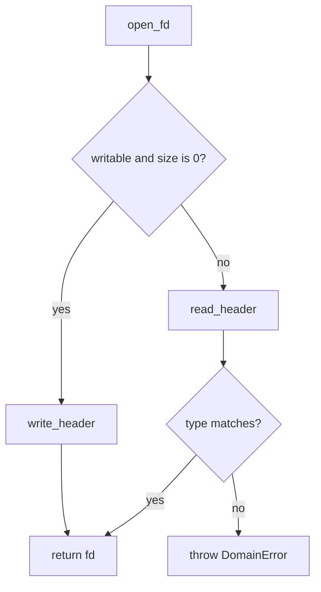

# Phase A tutorial: dates and fixed-width column files

> Drafted with AI assistance (Claude). Check the code against your own tests before relying on it.

Back to the checklist: [todo.md](todo.md). Extra reading per phase: [code_snippets.md](code_snippets.md).
Written for Obsidian: math uses `$...$`, diagrams use `mermaid`.

**Order to follow** (this matches the todo): A1, A2, A3, A4, A5, A8, A6, A7, A9.
A8 comes before A6 and A7 because their tests open a file first.

---

## 0. The loop for every step

1. Remove `[.todo]` from the next `TEST_CASE` (all Phase A tests are already unhidden).
2. Write the function.
3. Build and run only the tests for that step.

```sh
cmake --build build -j16 --target score_tests
make test-tag TAG="<filter from the table below>"
```

| Step | Filter | File |
|---|---|---|
| A1, A2 | `[date]` | `test_db_date_codec.cpp` |
| A3 | `value_size` | `test_db_column_file.cpp` |
| A4 | `encode_header*` and `header:*` | same |
| A5 | `decode_header*` | same |
| A8 | `open_column_file*` | same |
| A6, A7 | `write_rows*` | same |
| A9 | `is_valid_symbol` | same |
| whole phase | `[A]` | all |

> [!warning]
> `make test-cpp` depends on `build`, which wipes `build/`. Use `make test-tag` while iterating.

---

## 1. What we are building

One file holds one column of one symbol. A 16-byte header comes first, then the values packed with no gaps:

```
offset  0      4      6     7                16                16 + w            16 + 2w
        +------+------+-----+----------------+-----------------+-----------------+----
        | SCOL | ver  | typ | reserved (9 B) |     row 0       |     row 1       | ...
        +------+------+-----+----------------+-----------------+-----------------+----
```

| Bytes | Field | Notes |
|---|---|---|
| 0-3 | magic `SCOL` | identifies the file type |
| 4-5 | version | 16-bit, little-endian |
| 6 | `ColumnType` | `Int32 = 1`, `Int64 = 2`, `Float64 = 3` |
| 7-15 | reserved | must be zero |

### Why fixed width pays off

Let $w$ be the width of one value in bytes. Row $r$ starts at

$$\text{offset}(r) = 16 + r \cdot w$$

so finding a row is arithmetic, with no scanning. The header is 16 bytes on purpose: for $w = 8$ the offset $16 + 8r$ is always a multiple of 8, so a memory-mapped file can later be read as `const double*` without copying.

### Size at the design target

One bar is a date (4 B), four prices (4 x 8 B) and a volume (8 B), so 44 B. For 5,000 symbols over 30 years of about 252 trading days:

$$5000 \times 30 \times 252 \approx 3.78 \times 10^{7}\ \text{rows}, \qquad 3.78 \times 10^{7} \times 44\ \text{B} \approx 1.66\ \text{GB}$$

That is the "about 1.7 GB" in the todo decisions.

---

## 2. A1 and A2: dates as day counts

**Goal:** turn `"2024-02-29"` into an `int32` (days since 1970-01-01) and back.

Why an integer instead of the 10-byte string:

- It is 4 bytes instead of 10, which is $10 / 4 = 2.5\times$ smaller.
- It sorts like the calendar, so a date range is a binary search over a plain integer array:

$$d_1 < d_2 \iff \text{date}_1 \text{ is earlier than } \text{date}_2$$

- An `int32` covers $\pm 2^{31}$ days, about $\pm 5.9$ million years, which is far more than needed.

### The leap-year rule

$$\text{leap}(y) \iff (4 \mid y \ \wedge\ 100 \nmid y)\ \vee\ 400 \mid y$$

So 2000 is a leap year, 1900 is not, and 2024 is. The tests check exactly these (`2000-03-01 = 11017`, `1900-01-01 = -25567`).

### Technique

You do not hand-roll the calendar. `std::chrono` already knows it. Your work is **strict parsing** plus validation:

```cpp
// 1. shape: exactly "YYYY-MM-DD"
if (iso.length() != 10 || iso[4] != '-' || iso[7] != '-') throw score::DomainError("...");

// 2. each field: digits only (std::from_chars accepts "+1" and "-1", so reject signs yourself)
auto res = std::from_chars(first, last, value);
if (res.ec != std::errc{} || res.ptr != last || *first == '-' || *first == '+') throw ...;

// 3. a real date? ok() rejects 2023-02-30 and 2023-13-01
std::chrono::year_month_day ymd{std::chrono::year(y), std::chrono::month(m), std::chrono::day(d)};
if (!ymd.ok()) throw ...;

// 4. days since the epoch
return std::chrono::sys_days(ymd).time_since_epoch().count();
```

The inverse (A2):

```cpp
std::chrono::year_month_day ymd{std::chrono::sys_days{std::chrono::days{days}}};
return std::format("{:04}-{:02}-{:02}", int(ymd.year()), unsigned(ymd.month()), unsigned(ymd.day()));
```

`{:04}` and `{:02}` zero-pad, which is what the "zero-padded output" test checks. The round-trip property being tested is:

$$\text{iso\_from\_days}(\text{days\_from\_iso}(s)) = s$$

---

## 3. A3: `value_size`

Map each type to its width $w$:

| `ColumnType` | $w$ (bytes) | Holds |
|---|---|---|
| `Int32` | 4 | dates |
| `Int64` | 8 | volume |
| `Float64` | 8 | open, high, low, close |

```cpp
switch (type) {
    case ColumnType::Int32:   return 4;
    case ColumnType::Int64:   return 8;
    case ColumnType::Float64: return 8;
}
throw score::DomainError("score::db::value_size: unknown column type");
```

> [!tip] Why the `throw` after the switch
> The compiler cannot prove every possible `uint8_t` is a listed enumerator. Without the `throw`, an unknown value would fall off the end of the function, which is undefined behavior.

---

## 4. A4: `encode_header`

Build a zeroed 16-byte array, then fill the fields. Zero-initialising (`{}`) gives you the reserved bytes for free.

The 16-bit version $v$ is stored little-endian: low byte first.

$$b_4 = v \bmod 256, \qquad b_5 = \lfloor v / 256 \rfloor$$

```cpp
std::array<std::uint8_t, kColumnHeaderSize> out{};
std::copy(kColumnMagic.begin(), kColumnMagic.end(), out.begin());
out[4] = static_cast<std::uint8_t>(header.version & 0xFF);
out[5] = static_cast<std::uint8_t>(header.version >> 8);
out[6] = static_cast<std::uint8_t>(header.type);
return out;
```

Tests: `encode_header: exact bytes`, then `header: round trip for every type` (needs A5 too).

---

## 5. A5: `decode_header`

The reverse of A4, and the place where bad files get caught. The order of checks matters because each message should name the first thing that is wrong:

1. magic, 2. version, 3. reserved bytes, 4. type.

Small named helpers keep `decode_header` readable (they live in the anonymous namespace in `column_file.cpp`):

```cpp
bool magic_matches(std::span<const std::uint8_t, kColumnHeaderSize> bytes) {
    return std::equal(kColumnMagic.begin(), kColumnMagic.end(), bytes.begin());
}
bool version_matches(std::span<const std::uint8_t, kColumnHeaderSize> bytes) {
    return bytes[4] == static_cast<std::uint8_t>(kColumnFormatVersion) &&
           bytes[5] == static_cast<std::uint8_t>(kColumnFormatVersion >> 8);
}
bool reserved_is_zero(std::span<const std::uint8_t, kColumnHeaderSize> bytes) {
    return std::all_of(bytes.begin() + 7, bytes.end(), [](std::uint8_t b) { return b == 0; });
}
```

```cpp
if (!magic_matches(bytes))    throw score::DomainError("...magic number mismatch");
if (!version_matches(bytes))  throw score::DomainError("...version mismatch");
if (!reserved_is_zero(bytes)) throw score::DomainError("...reserved bytes are not zero");

switch (static_cast<ColumnType>(bytes[6])) {
    case ColumnType::Int32:   return ColumnHeader{kColumnFormatVersion, ColumnType::Int32};
    case ColumnType::Int64:   return ColumnHeader{kColumnFormatVersion, ColumnType::Int64};
    case ColumnType::Float64: return ColumnHeader{kColumnFormatVersion, ColumnType::Float64};
}
throw score::DomainError("...unknown column type");
```

> [!bug] Two mistakes already made once, so they are worth remembering
> - `case` labels of a `switch` on an `enum class` must be enumerators (`case ColumnType::Int32:`), not casts to `uint8_t`.
> - Reserved means bytes **7 to 15**, not just byte 7. The test sets byte 15 and expects a throw.

---

## 6. The I/O helpers used by A6 to A8

These sit in the anonymous namespace in `column_file.cpp`. You call them; you do not need to rewrite them.

| Helper | Use |
|---|---|
| `row_offset(first_row, type)` | $16 + r \cdot w$ as an `off_t` |
| `pwrite_all(fd, bytes, offset)` | writes every byte; retries `EINTR` and short writes |
| `pread_all(fd, out, offset)` | fills `out`; a file that ends early throws `DomainError` |
| `open_fd(path, writable)` | `::open` with `O_CLOEXEC` and mode 0644; errors become `system_error` |
| `file_size_of(fd)` | size via `fstat` |
| `write_header(fd, type)` | writes a fresh header at offset 0 |
| `read_header(fd)` | reads and validates the header at offset 0 |
| `is_symbol_char(c)` / `kMaxSymbolLength` | for A9 |

### Why a loop around `pread` and `pwrite`

Both return the number of bytes actually transferred, $n$, which can be smaller than requested. Treat the call as correct only when the running total reaches the target:

$$\text{done}_0 = 0, \quad \text{done}_{k+1} = \text{done}_k + n_k, \quad \text{stop when } \text{done} = N$$

A result of $n = -1$ with `errno == EINTR` means "interrupted, try again". Any other $-1$ is a real error.

---

## 7. A8: `open_column_file` (do this before A6 and A7)



```cpp
UniqueFd fd = open_fd(path, writable);

if (writable && file_size_of(fd.get()) == 0) {
    write_header(fd.get(), type);
    return fd;
}
if (read_header(fd.get()).type != type) {
    throw score::DomainError("score::db::open_column_file: column type mismatch");
}
return fd;
```

How each test is satisfied:

| Test | Why it passes |
|---|---|
| creates a file holding only a header | new file, size 0, so a header is written; file size is exactly 16 |
| reopening checks the type | size is 16, so no rewrite; a different type throws `DomainError` |
| read-only open of a missing file | no `O_CREAT`, so `open` fails with `ENOENT`; no file is created |
| a file that is not a column file | `read_header` fails the magic check, so `DomainError` |

> [!note] Not handled yet
> Two processes creating the same file at the same moment can both see size 0. That race is Phase D's problem (per-symbol `flock`).

---

## 8. A6: `write_rows`

Rows are addressed by index, so the only math is the offset from section 1 and a length check. The input is raw bytes, so the byte count $n$ must be a whole number of values:

$$n \bmod w = 0$$

```cpp
const std::size_t w = value_size(type);
if (values.size() % w != 0) throw score::DomainError("...not a multiple of the value size");
pwrite_all(fd, values, row_offset(first_row, type));
```

The little-endian test works because the bytes go to disk exactly as they sit in memory. `static_assert(std::endian::native == std::endian::little)` in the header guards that assumption.

---

## 9. A7: `read_rows`

Same offset, opposite direction. Allocate exactly $n_{\text{rows}} \cdot w$ bytes and fill them:

```cpp
std::vector<std::byte> out(n_rows * value_size(type));
pread_all(fd, out, row_offset(first_row, type));
return out;
```

Edge cases the "bad sizes" test covers:

| Call (file has 2 rows) | Result |
|---|---|
| `read_rows(fd, Float64, 1, 2)` | needs rows 1 and 2, only row 1 exists, so `pread` returns 0 early and `DomainError` is thrown |
| `read_rows(fd, Float64, 2, 0)` | empty vector; `pread_all` does nothing for an empty buffer |

---

## 10. A9: `is_valid_symbol`

The symbol becomes a directory name, so this is a **security check** against paths like `../etc`. The allowed set is

$$[A\text{-}Z\,a\text{-}z\,0\text{-}9\,.\,\_\,\hat{}\,=\,-]$$

with length $1 \le \ell \le 32$ and no leading `.`. Rejecting a leading dot is what rules out `.` and `..`; leaving `/` and `\` out of the set rules out separators.

```cpp
if (symbol.empty() || symbol.size() > kMaxSymbolLength || symbol.front() == '.') return false;
return std::all_of(symbol.begin(), symbol.end(), is_symbol_char);
```

Why the test strings matter:

| Input | Rejected by |
|---|---|
| `""`, `"."`, `".."`, `".hidden"` | empty or leading dot |
| `"a/b"`, `"../etc"`, `"a\\b"` | `/` or `\` not in the set |
| `"A B"`, `"AAPL\n"` | space and newline not in the set |
| `"é"` | non-ASCII bytes not in the set |
| 33 characters | too long |
| `"AA\0PL"` (embedded NUL) | `\0` not in the set; `string_view` keeps the full length |

---

## 11. Finish line

```sh
make test-tag TAG="[A]"
```

All Phase A tests should pass. Then move to Phase B (commit marker).

---

## 12. Notes: what was done and how

**Result:** `make test-tag TAG="[A]"` passes: 19 test cases, 925 assertions (6 date-codec tests plus 13 column-file tests). A1 to A9 are ticked in [todo.md](todo.md).

### What was done, per step

| Step | What was written | How |
|---|---|---|
| A1, A2 | `days_from_iso`, `iso_from_days` in `date_codec.cpp` | strict digit parsing with `std::from_chars`, then `std::chrono::year_month_day::ok()` and `sys_days` for the calendar |
| A3 | `value_size` | a `switch` over `ColumnType`, plus a `throw` after it |
| A4 | `encode_header` | zeroed `std::array`, copy the magic, version as two little-endian bytes, then the type byte |
| A5 | `decode_header` | checks in order (magic, version, reserved, type), each check a named helper |
| A8 | `open_column_file` | `open_fd`, then either `write_header` (new writable file) or `read_header` and a type compare |
| A6 | `write_rows` | modulo check on the byte count, then `pwrite_all` at `row_offset` |
| A7 | `read_rows` | allocate `n_rows * w` bytes, then `pread_all` at `row_offset` |
| A9 | `is_valid_symbol` | early return on empty, too long, or leading `.`, then `std::all_of` with `is_symbol_char` |

### Design choices

- **Helpers in an anonymous namespace**, not in `column_file.hpp`. The header is the format spec, so it only lists the public API. The I/O loops (`pread_all`, `pwrite_all`) exist once, so `write_rows`, `read_rows` and `read_header` all share the same handling of short reads and `EINTR`.
- **`std::chrono` for dates** instead of a hand-written civil-calendar algorithm: less code, and the standard library already handles leap years.
- **Explicit character ranges** in `is_symbol_char` instead of `isalnum`, so the result does not depend on the locale.
- **No new test files.** All A-tagged tests already existed and were unhidden by removing `[.todo]`.

### Bugs found along the way

| Symptom | Cause | Fix |
|---|---|---|
| build failed in `decode_header` | `case` labels were `uint8_t` casts, but the switch was on an `enum class` | switch on `static_cast<ColumnType>(bytes[6])` with enumerator labels |
| `bad_reserved` test failed | only byte 7 was checked; the spec reserves 7 to 15 | `std::all_of` over `bytes.begin() + 7` to the end |
| `make test-tag TAG="[A6]"` ran nothing | no `[A6]` tag exists; tests are tagged only `[A]` | filter by name (`write_rows*`) or by `[A]` |
| build failed in `open_column_file` | a half-typed `if(symbol.empty() \|)` from A9 was left in the wrong function | moved the idea into `is_valid_symbol` and wrote the real body |
| `read_rows` had no return value | the `return output;` line was missing | added it |

### Known limits (deliberately left for later phases)

- **Two processes creating the same file at once** can both see size 0 and both write a header. Phase D's per-symbol `flock` fixes this.
- **No crash safety yet.** A crash mid-append can leave a half-written row. Phase B adds the committed row-count marker.
- **Little-endian hosts only.** The header has a `static_assert` for it; on a big-endian machine the file format would be wrong, not just slower.
