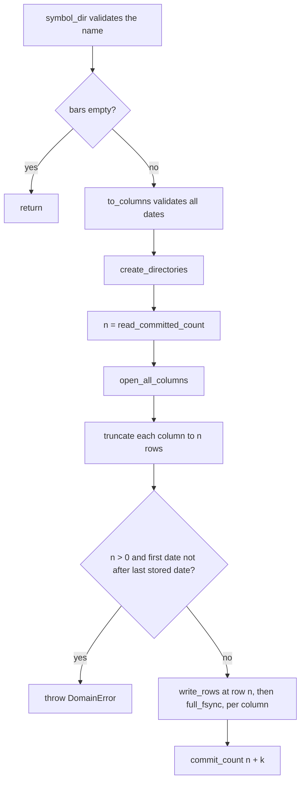

# Phase B tutorial: an append that survives a crash

> Drafted with AI assistance (Claude). Check the code against your own tests before relying on it.

Back to the checklist: [todo.md](todo.md). Previous phase: [phase_a_readme.md](phase_a_readme.md). Extra reading: [code_snippets.md](code_snippets.md), "Phase B".

> [!info] Obsidian setup for the diagrams
> The diagrams are `tikz` code blocks. Install the community plugin **TikZJax** (Settings, Community plugins, Browse, search "TikZJax"). Math (`$...$`) and the `mermaid` blocks work without any plugin. If a diagram shows as code, the plugin is not enabled yet.

**Order to follow:** B1, B2, B3, B4, B5, B6, B7, B9, B8, then the two `IngestionSource` tests, then the by-hand crash check.

---

## 0. The loop for every step

All Phase B tests are already unhidden (`[.todo]` removed). Right now all 19 fail with `Not implemented`; that message names what to write next.

```sh
cmake --build build -j16 --target score_tests
make test-tag TAG="<filter>"
```

| Step | Filter | File |
|---|---|---|
| B1, B2 | `full_fsync*` | `test_db_symbol_dir.cpp` |
| B3 | `read_committed_count*` | same |
| B4 | `commit_count*` | same |
| B5 | `truncate_to_rows*` | same |
| B6 to B9 | `ColumnStoreV1*` (or `[columnstore][B]`) | `test_db_column_store.cpp` |
| whole phase | `[B]` | both |

> [!warning]
> `make test-cpp` wipes `build/` first. Use `make test-tag` while iterating.

---

## 1. The problem

Phase A could write a column file. Phase B makes **an append of $k$ bars** safe. One append touches six column files plus a count, and a crash can stop it anywhere:

| Where the crash hits | What is on disk | Is that acceptable? |
|---|---|---|
| after writing 2 of 6 columns | two files longer than the rest | not unless readers ignore the extra rows |
| after writing all 6, before the count | six longer files | same |
| halfway through writing the count | a count that is neither old nor new | **never** |

The design from [todo.md](todo.md) (decision 5) is a **committed row count**, one small file `COUNT`. It is the single source of truth:

$$\text{visible rows of a symbol} = \texttt{COUNT}$$

Rows at index $\ge \texttt{COUNT}$ are garbage from an unfinished append. Readers never look at them, and the next writer truncates them away.

```tikz
\begin{document}
\begin{tikzpicture}[x=1cm,y=1cm]
\foreach \i in {0,1,2,3,4} {
  \draw[fill=green!25] (\i*1.2,0) rectangle +(1.1,0.8);
  \node at (\i*1.2+0.55,0.4) {\i};
}
\foreach \i in {5,6} {
  \draw[fill=gray!30,dashed] (\i*1.2,0) rectangle +(1.1,0.8);
  \node at (\i*1.2+0.55,0.4) {\i};
}
\draw[very thick,red] (5.95,-0.3) -- (5.95,1.1);
\node[red] at (5.95,-0.7) {COUNT = 5};
\node at (2.9,1.5) {\small readers see rows 0 to 4};
\node at (8.4,1.5) {\small garbage, ignored};
\end{tikzpicture}
\end{document}
```

The goal of the whole phase, stated as an invariant. Let $n$ be the old count. At any instant, including after a crash, a reader sees exactly one of two states:

$$\text{visible rows} \in \{\,n,\ n + k\,\}$$

There is no third state, so "half an append" cannot be observed.

---

## 2. Why `write` alone is not enough

`write()` only copies bytes into the operating system's cache. If the power fails before the cache reaches the disk, the bytes are lost, and the disk may even hold later writes without earlier ones. Two tools fix this:

1. **`fsync`** forces a file's bytes to the device before it returns.
2. **`rename`** replaces a file atomically: a reader sees the old file or the new one, never a mix.

The count must only change **after** the rows it counts are durable. Writing $D(x)$ for "$x$ is durable on disk" and $t(\cdot)$ for the moment something happens:

$$t\big(D(\text{all six column files})\big)\ <\ t\big(\text{rename of } \texttt{COUNT.tmp}\big)$$

Break this order and a crash can leave a `COUNT` that points at rows that never reached the disk.

The full append, with the single commit point:

```tikz
\begin{document}
\begin{tikzpicture}[>=stealth]
\node[draw,rounded corners,fill=blue!10,minimum width=7cm,minimum height=0.8cm] (a) at (0,0) {1. truncate every column to COUNT rows};
\node[draw,rounded corners,fill=blue!10,minimum width=7cm,minimum height=0.8cm] (b) at (0,-1.3) {2. write the new rows into six files};
\node[draw,rounded corners,fill=blue!10,minimum width=7cm,minimum height=0.8cm] (c) at (0,-2.6) {3. fsync each of the six files};
\node[draw,rounded corners,fill=blue!10,minimum width=7cm,minimum height=0.8cm] (d) at (0,-3.9) {4. write COUNT.tmp, then fsync it};
\node[draw,rounded corners,very thick,red,fill=red!10,minimum width=7cm,minimum height=0.8cm] (e) at (0,-5.2) {5. rename COUNT.tmp to COUNT};
\node[draw,rounded corners,fill=green!15,minimum width=7cm,minimum height=0.8cm] (f) at (0,-6.5) {6. fsync the directory};
\draw[->] (a) -- (b);
\draw[->] (b) -- (c);
\draw[->] (c) -- (d);
\draw[->] (d) -- (e);
\draw[->] (e) -- (f);
\draw[decorate,decoration={brace,amplitude=6pt,mirror}] (3.7,0.4) -- (3.7,-4.3);
\node[align=left,anchor=west] at (4.1,-1.95) {\small crash here:\\\small old count,\\\small append lost};
\node[align=left,anchor=west,red] at (4.1,-5.2) {\small commit point:\\\small new count};
\end{tikzpicture}
\end{document}
```

> [!note]
> The brace decoration needs `decorations.pathreplacing`. If your TikZJax build rejects it, delete the two `decorate` lines; the diagram still reads correctly.

Recovery needs no special mode. Every append begins by truncating the columns to `COUNT` rows (step 1). After a crash this removes the garbage; with no crash it does nothing.

---

## 3. The helpers you get

All are small and tested by the rest of the code; you call them.

| File | Helper | Use |
|---|---|---|
| `src/db/fd_io.hpp` | `pwrite_all(fd, bytes, offset)`, `pread_all(fd, out, offset)` | the retrying I/O loops from Phase A, now shared |
| `symbol_dir.cpp` | `open_path(path, flags)` | `open(2)` with `O_CLOEXEC`; failure throws `system_error` (B2, B3, B4) |
| `symbol_dir.cpp` | `encode_count(n)`, `decode_count(bytes)` | 8-byte little-endian conversion (B3, B4) |
| `column_store_v1.cpp` | `kColumns` | file name and type for each of the six columns |
| `column_store_v1.cpp` | `to_columns(bars)` | bars to six arrays; validates dates; touches no files (B7 step 0) |
| `column_store_v1.cpp` | `bytes_of(data, i)` | one column's bytes, ready for `write_rows` (B7) |
| `column_store_v1.cpp` | `open_all_columns(dir)` | opens the six files, in `kColumns` order (B7) |
| `column_store_v1.cpp` | `last_date(date_fd, n)` | the last committed date, for the overlap check (B7) |

The count is stored as 8 little-endian bytes, so for $c = \texttt{COUNT}$:

$$b_i = \left\lfloor \frac{c}{256^{\,i}} \right\rfloor \bmod 256, \qquad c = \sum_{i=0}^{7} b_i \cdot 256^{\,i}$$****

For example $c = 258 = 0\mathrm{x}0102$ gives bytes `02 01 00 00 00 00 00 00`, which is exactly what the test `commit_count: COUNT is 8 little-endian bytes` checks.

---

## 4. B1: `full_fsync`

Linux `fsync` is enough. On macOS `fsync` stops at the drive's write cache, so `F_FULLFSYNC` is needed:

```cpp
void full_fsync(int fd) {
#if defined(__APPLE__)
    const int rc = ::fcntl(fd, F_FULLFSYNC);
#else
    const int rc = ::fsync(fd);
#endif
    if(rc != 0) {
        throw std::system_error(errno, std::generic_category(), "fsync");
    }
}
```

The test passes `-1` and expects `std::system_error`. That works because `fsync(-1)` fails with `EBADF`.

---

## 5. B2: `fsync_directory`

Creating or renaming a file edits its **directory**. Without the directory's own `fsync`, a file can vanish after a crash even though its contents were flushed.

```cpp
void fsync_directory(const std::filesystem::path& dir) {
    UniqueFd fd = open_path(dir, O_RDONLY | O_DIRECTORY);
    if(::fsync(fd.get()) != 0) {
        throw std::system_error(errno, std::generic_category(), "fsync directory");
    }
}
```

A missing directory makes `open_path` throw `system_error`, which is the second thing the test checks. Plain `fsync` is correct for a directory, also on macOS. `UniqueFd` closes the descriptor for you.

Run: `make test-tag TAG="full_fsync*"`.

---

## 6. B3: `read_committed_count`

Three cases: no `COUNT` means zero rows; a `COUNT` of any size other than 8 bytes is corruption; otherwise decode the 8 bytes. The leftover `COUNT.tmp` must never be read.

```cpp
std::size_t read_committed_count(const std::filesystem::path& symbol_dir) {
    const auto path = symbol_dir / kCountFileName;
    if(!std::filesystem::exists(path)) { return 0; }
    if(std::filesystem::file_size(path) != kCountBytes) {
        throw score::DomainError("score::db::read_committed_count: COUNT is not 8 bytes");
    }
    UniqueFd fd = open_path(path, O_RDONLY);
    std::array<std::byte, kCountBytes> bytes{};
    pread_all(fd.get(), bytes, 0);
    return decode_count(bytes);
}
```

Why checking the size is safe even if the file is replaced between the two calls: `COUNT` only ever changes by `rename`, so any file you open is a complete 8-byte file, old or new.

Run: `make test-tag TAG="read_committed_count*"`. The test with the 3-byte `COUNT` is the corruption case.

---

## 7. B4: `commit_count` (the order is the whole point)

```tikz
\begin{document}
\begin{tikzpicture}[>=stealth]
\node[draw,minimum width=3cm,minimum height=1.6cm,align=center] (b1) at (0,0) {\texttt{COUNT}\\ \texttt{= 5}};
\node[below=0.2cm of b1] {\small before};
\node[draw,minimum width=3cm,minimum height=0.8cm,align=center] (c2) at (4.5,0.4) {\texttt{COUNT = 5}};
\node[draw,dashed,fill=yellow!20,minimum width=3cm,minimum height=0.8cm,align=center] (t2) at (4.5,-0.6) {\texttt{COUNT.tmp = 7}};
\node at (4.5,-1.5) {\small tmp written and fsynced};
\node[draw,minimum width=3cm,minimum height=1.6cm,align=center,fill=green!15] (b3) at (9,0) {\texttt{COUNT}\\ \texttt{= 7}};
\node at (9,-1.5) {\small after rename};
\draw[->,thick] (1.7,0) -- (2.8,0);
\draw[->,very thick,red] (6.3,0) -- (7.3,0) node[midway,above] {\small rename};
\end{tikzpicture}
\end{document}
```

```cpp
void commit_count(const std::filesystem::path& symbol_dir, std::size_t n_rows) {
    const auto tmp = symbol_dir / kCountTmpFileName;
    {
        UniqueFd fd = open_path(tmp, O_WRONLY | O_CREAT | O_TRUNC);
        const auto bytes = encode_count(n_rows);
        pwrite_all(fd.get(), bytes, 0);
        full_fsync(fd.get());
    }  // closed here
    std::filesystem::rename(tmp, symbol_dir / kCountFileName);
    fsync_directory(symbol_dir);
}
```

| Line | Why it is there |
|---|---|
| `O_TRUNC` | a stale `COUNT.tmp` from an earlier crash must be overwritten, not appended to |
| `full_fsync` before the rename | otherwise the new name could point at an empty file after a crash |
| `std::filesystem::rename` | the commit point; it is atomic on POSIX |
| `fsync_directory` last | makes the rename itself survive a crash |

The test "a leftover COUNT.tmp is ignored" checks all of this: `read_committed_count` returns 0, then a later `commit_count` still succeeds despite a stale temp file.

Run: `make test-tag TAG="commit_count*"` and `make test-tag TAG="read_committed_count*"`.

---

## 8. B5: `truncate_to_rows`

A column file holding $n$ rows of width $w$ has exactly

$$s = 16 + n \cdot w \ \text{bytes}$$

`ftruncate` sets the size to $s$. It shrinks (removes garbage rows) or extends (zero-fills):

```cpp
void truncate_to_rows(int fd, ColumnType type, std::size_t n_rows) {
    const auto size = static_cast<off_t>(kColumnHeaderSize + n_rows * value_size(type));
    if(::ftruncate(fd, size) != 0) {
        throw std::system_error(errno, std::generic_category(), "ftruncate");
    }
}
```

The 16-byte header is never cut: the test truncates to 0 rows and then reopens the file to prove the header survived.

Run: `make test-tag TAG="truncate_to_rows*"`.

---

## 9. B6: `ColumnStoreV1::symbol_dir`

The symbol becomes a directory name, so the check from Phase A (A9) is a security barrier against `../etc`:

```cpp
std::filesystem::path ColumnStoreV1::symbol_dir(const std::string& symbol) const {
    if(!is_valid_symbol(symbol)) {
        throw score::DomainError("score::db::ColumnStoreV1: invalid symbol name");
    }
    return root_dir_ / symbol;
}
```

Because both `append` and `count` start with this call, the test "unsafe symbol names are rejected" is satisfied for both, and no directory outside the store is ever created.

---

## 10. B7: `ColumnStoreV1::append`

This is the step where everything meets. Follow the figure in section 2, top to bottom.



```cpp
void ColumnStoreV1::append(const std::string& symbol, const std::vector<Bar>& bars) {
    const auto dir = symbol_dir(symbol);
    if(bars.empty()) { return; }

    const ColumnData data = to_columns(bars);          // bad or unsorted dates throw here, before any I/O
    std::filesystem::create_directories(dir);

    // Phase D adds the lock here:  SymbolLock lock(dir);
    const std::size_t n  = read_committed_count(dir);
    auto              fds = open_all_columns(dir);

    for(std::size_t i = 0; i < kColumns.size(); ++i) {
        truncate_to_rows(fds[i].get(), kColumns[i].type, n);   // removes rows left by a crashed append
    }

    if(n > 0 && data.date.front() <= last_date(fds[0].get(), n)) {
        throw score::DomainError("score::db::ColumnStoreV1::append: bars overlap stored dates");
    }

    for(std::size_t i = 0; i < kColumns.size(); ++i) {
        write_rows(fds[i].get(), kColumns[i].type, n, bytes_of(data, i));
        full_fsync(fds[i].get());
    }
    commit_count(dir, n + bars.size());                  // the append becomes visible here
}
```

How the tests are met:

| Test | What makes it pass |
|---|---|
| appending nothing | the early `return` creates no directory, so `symbols()` stays empty |
| out-of-order and overlapping | `to_columns` rejects an unsorted batch; the `last_date` check rejects overlap with stored data; nothing is written before either check |
| a bad date rejects the whole append | `days_from_iso` throws inside `to_columns`, before the disk is touched |
| recovery from a half-finished append | the garbage rows (and the stale `COUNT.tmp`) are removed by the truncate in step 1 and the `O_TRUNC` in `commit_count` |
| a second append continues the first | `n` is read from `COUNT`, so rows are written at index $n$, not 0 |
| on-disk layout | date file is $16 + 7 \cdot 4$ bytes, the rest $16 + 7 \cdot 8$; no `COUNT.tmp` is left behind |

> [!note] Creating the six files
> Opening a new column file writes its header, which edits the directory. The final `fsync_directory` inside `commit_count` covers those new entries too, because they are all in the same directory.

> [!warning] Two writers at once
> Two processes appending to the same symbol can both read the same `n` and overwrite each other. That is Phase D (`SymbolLock`); leave the lock out for now.

---

## 11. B9 then B8: `count` and `symbols`

```cpp
std::size_t ColumnStoreV1::count(const std::string& symbol) const {
    return read_committed_count(symbol_dir(symbol));
}
```

An unknown symbol has no directory, so no `COUNT`, so the answer is 0 with no special case. An invalid symbol still throws, because of `symbol_dir`.

```cpp
std::vector<std::string> ColumnStoreV1::symbols() const {
    std::vector<std::string> out;
    for(const auto& entry : std::filesystem::directory_iterator(root_dir_)) {
        if(entry.is_directory() && read_committed_count(entry.path()) > 0) {
            out.push_back(entry.path().filename().string());
        }
    }
    std::sort(out.begin(), out.end());
    return out;
}
```

The `> 0` test is the "ghost" rule. A directory with no `COUNT` is a symbol whose first append never committed, so as far as readers are concerned it does not exist. Add `#include <algorithm>` for `std::sort`.

Run: `make test-tag TAG="ColumnStoreV1*"`. Tests tagged `[C]` and `[D]` also match this filter and are still hidden, so use `[columnstore][B]` to run only Phase B.

---

## 12. The two ingestion tests

`test_ingestion.cpp` needs only `append` and `count`. They are tagged `[E]` and still hidden, so select them by name:

```sh
make test-tag TAG="IngestionSource*"
```

Remove `[.todo]` from those two `TEST_CASE`s once Phase B passes, then tick the box in [todo.md](todo.md).

---

## 13. By hand, once: kill an append in the middle

The automated recovery test fakes a crash by writing garbage. This check makes a real one.

1. In `append`, add a temporary line inside the write loop, after the second column is written:

   ```cpp
   if(n > 0 && i == 2) { std::abort(); }   // TEMPORARY
   ```
2. Run `make test-tag TAG="ColumnStoreV1: a second append continues the first"`. The process aborts during the second append, and the temp directory is **not** cleaned up.
3. Inspect it:

   ```sh
   ls -l /tmp/score_db_*/AAPL/        # some columns are longer than the others
   xxd /tmp/score_db_*/AAPL/COUNT     # still 05 00 00 00 00 00 00 00
   ```
4. Remove the `abort` line, run the same test again. It passes, which shows the next writer truncated the garbage and appended cleanly.
5. Clean up the left-over directories and remove the temporary line.

`COUNT` still reading 5 after the abort is the proof of the invariant in section 1.

---

## 14. Common mistakes

| Mistake | Why it breaks |
|---|---|
| `commit_count` renames before `full_fsync` of the temp file | a crash can leave `COUNT` pointing at an empty file |
| forgetting `fsync_directory` | the rename can be lost after a crash |
| omitting `O_TRUNC` on `COUNT.tmp` | a stale temp file longer than 8 bytes makes `COUNT` the wrong size |
| committing before fsyncing the six columns | the count can outlive the rows it counts |
| truncating after writing instead of before | the new rows would be cut or the old garbage kept |
| writing rows at index 0 instead of $n$ | overwrites committed data |
| `symbols()` listing a directory with no `COUNT` | exposes a symbol whose first append never committed |

---

## 15. Finish line

```sh
make test-tag TAG="[B]"
```

All 19 Phase B tests should pass, plus the two `IngestionSource` tests. Then tick B1 to B9 in [todo.md](todo.md), and Phase C (readers) is next.

---

## 16. Notes: what was done and how

**Result:** `make test-tag TAG="[B]"` passes (19 cases, 62 assertions), and so do both `IngestionSource` tests (2 cases). Phase A still passes (19 cases, 925 assertions). B1 to B9 and the ingestion item are ticked in [todo.md](todo.md); the by-hand `kill` check (section 13) is still open.

### What was written

| Step | Function | How |
|---|---|---|
| B1 | `full_fsync` | `F_FULLFSYNC` on macOS, `fsync` elsewhere; failure goes through `throw_errno` |
| B2 | `fsync_directory` | `open_path` on the directory, then `fsync` |
| B3 | `read_committed_count` | missing `COUNT` returns 0; wrong size throws `DomainError`; otherwise `pread_all` and `decode_count` |
| B4 | `commit_count` | `write_file_durably` the temp file, `rename` it over `COUNT`, then `fsync_directory` |
| B5 | `truncate_to_rows` | `ftruncate` to `16 + n_rows * value_size` |
| B6 | `ColumnStoreV1::symbol_dir` | `is_valid_symbol`, else `DomainError`; returns `root_dir_ / symbol` |
| B7 | `ColumnStoreV1::append` | validate, truncate to the committed count, overlap check, write and fsync each column, then `commit_count` |
| B8 | `ColumnStoreV1::symbols` | directories with a non-zero committed count, sorted |
| B9 | `ColumnStoreV1::count` | `read_committed_count(symbol_dir(symbol))` |

### Helpers added in the final pass

| Helper | Where | What it removes |
|---|---|---|
| `throw_errno(what)` | `symbol_dir.cpp` | the repeated `std::system_error(errno, generic_category(), ...)` line in B1, B2, B5 |
| `write_file_durably(path, bytes)` | `symbol_dir.cpp` | the open, write, fsync sequence from `commit_count` |
| `kDateColumn` | `column_store_v1.cpp` | the bare index `0` for the date file in `append` |

### Lambdas used

- `for_each_column` in `append` runs one action per column, so truncating and writing share one loop instead of two copies.
- `has_committed_rows` in `symbols` names the ghost-symbol rule at the point where it is used.

### Design choices

- **Truncate first, always.** Recovery from a crash is not a separate code path. Every append truncates the columns to the committed count, which is a no-op when nothing went wrong.
- **Validate before touching disk.** `symbol_dir` and `to_columns` run before `create_directories`, so a rejected append creates nothing.
- **Variable names say what they hold:** `committed_rows`, `new_rows`, `column_fds`, `symbol_path`, `count_bytes`, rather than `n`, `data`, `fds`, `dir`.

### Known limits (left for later phases)

- **Two writers on one symbol** can read the same `committed_rows` and overwrite each other. Phase D's `SymbolLock` fixes this; the call site is marked with a comment in `append`.
- **The crash check is by hand.** The automated recovery test writes garbage to fake a crash; section 13 produces a real one.
