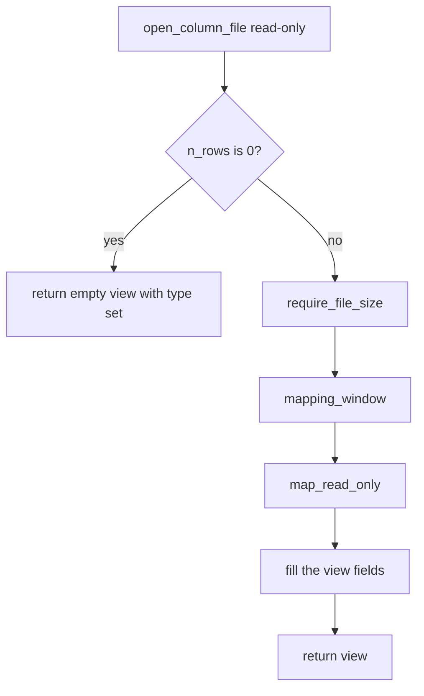
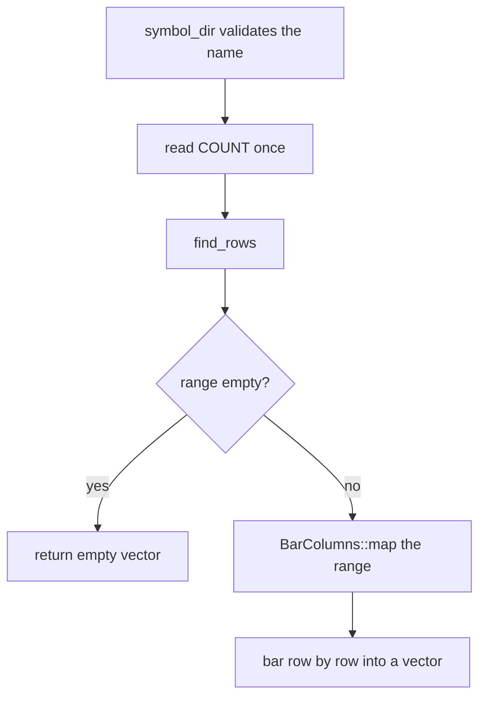

# Phase C tutorial: reading without copying

> Drafted with AI assistance (Claude). Every snippet below was compiled and run against the Phase C tests before this was written.

Back to the checklist: [todo.md](todo.md). Previous phases: [phase_a_readme.md](phase_a_readme.md), [phase_b_readme.md](phase_b_readme.md). Extra reading: [code_snippets.md](code_snippets.md), "Phase C".

> [!info] Diagrams
> The `tikz` blocks need the TikZJax plugin in Obsidian, or Markdown Preview Enhanced in VS Code. Math and `mermaid` need nothing extra.

**Order to follow:** C3, C1, C2, C4, C5 (the whole `ColumnView`), then C6, C7, C8, then C9.
The first `ColumnView` test calls `f64()`, so write the accessors before you run anything.

---

## 0. The loop for every step

All Phase C tests are already unhidden. Right now all 18 fail with `Not implemented`.

```sh
cmake --build build -j16 --target score_tests
make test-tag TAG="<filter>"
```

| Step | Filter | File |
|---|---|---|
| C1 to C5 | `[column_view]` | `test_db_column_view.cpp` (10 tests) |
| C6, C7, C8 | `[columnstore][C]` | `test_db_column_store.cpp` (8 tests) |
| C9 | `[risk]`, `[stats]`, then `make test-py` | `test_risk.cpp`, `test_statistics.cpp` |
| whole phase | `[C]` | all |

> [!warning]
> `make test-cpp` wipes `build/` first. Use `make test-tag` while iterating.

---

## 1. The idea

Phase B made data safe on disk. Phase C reads it back **without copying**. `mmap` makes a file's bytes appear at a memory address. Nothing is read until you touch a page, and nothing is copied into your own buffers: the `std::span` you return points straight into the operating system's page cache.

Two problems to solve:

1. **Which rows?** A query gives two dates. The date column is sorted, so two binary searches turn them into a row range.
2. **Which bytes?** `mmap` only accepts offsets that are multiples of the page size, so the mapping has to start a little before the first row.

### The page-alignment math

Let $w$ be the row width in bytes, $P$ the page size (4096 on x86-64, 16384 on Apple silicon), $r$ the first row and $n$ the number of rows.

$$b = 16 + r\,w \qquad a = b - (b \bmod P) \qquad \ell = b - a \qquad L = \ell + n\,w$$

| Symbol | Meaning                          | Name in the code |
| ------ | -------------------------------- | ---------------- |
| $b$    | byte offset of the first row     | `byte_offset`    |
| $a$    | page boundary at or below $b$    | `aligned_offset` |
| $\ell$ | bytes to skip inside the mapping | `lead_bytes`     |
| $L$    | bytes to map                     | `length`         |

`mmap` is called with offset $a$ and length $L$. The pointer you hand out is `base + \ell`.

```tikz
\begin{document}
\begin{tikzpicture}[x=1cm,y=1cm]
\draw[fill=gray!30] (0,0) rectangle (0.8,0.8);
\node at (0.4,0.4) {\scriptsize hdr};
\foreach \k in {0,...,9} {
  \draw[fill=blue!10] (0.8+\k*0.9,0) rectangle +(0.9,0.8);
  \node at (0.8+\k*0.9+0.45,0.4) {\scriptsize \k};
}
\foreach \p in {0,4,8} {
  \draw[dashed,red] (\p,-0.4) -- (\p,1.2);
}
\node[red] at (0,-0.7) {\scriptsize page 0};
\node[red] at (4,-0.7) {\scriptsize page 1};
\node[red] at (8,-0.7) {\scriptsize page 2};
\draw[very thick,green!50!black] (4.4,-0.1) rectangle (8.0,0.9);
\draw[<->] (4,1.5) -- (4.4,1.5) node[midway,above] {\scriptsize lead};
\node at (6.2,1.6) {\small rows 4 to 7 requested};
\end{tikzpicture}
\end{document}
```

Rows 4 to 7 start 0.4 into page 1. The mapping begins at the page boundary, and `lead_bytes` is the gap.

### Why casting the bytes to `double*` is safe

Reading bytes as `const double*` needs an address divisible by 8. The mapping starts on a page boundary, and $P$ is a multiple of $w$. So the address of row $r$ is congruent to $b$ modulo $w$:

$$b = 16 + r\,w \equiv 0 \pmod{w}$$

because 16 is divisible by both 4 and 8. That is the reason the header is 16 bytes: a 7- or 10-byte header would break this.

### Finding a date range

With the dates $d_0 \le d_1 \le \dots$ sorted ascending, a query for $[s, e]$ (both ends inclusive) is:

$$\text{first} = \min\{\,j : d_j \ge s\,\} \qquad \text{last} = \min\{\,j : d_j > e\,\} \qquad \text{count} = \max(0,\ \text{last} - \text{first})$$

`std::lower_bound` gives `first` and `std::upper_bound` gives `last`. This handles dates that are not stored (weekends) and an inverted range ($s > e$ makes the count 0) with no special cases. For 30 years of about 252 days, $n = 7560$ rows, so a search takes at most $\lceil \log_2 7560 \rceil = 13$ comparisons instead of 7560.

```tikz
\begin{document}
\begin{tikzpicture}[x=1cm,y=1cm]
\foreach \k/\v in {0/a,1/b,2/c,3/d,4/e,5/f,6/g,7/h} {
  \draw[fill=white] (\k*1.1,0) rectangle +(1.0,0.8);
  \node at (\k*1.1+0.5,0.4) {\scriptsize d\k};
}
\foreach \k in {2,3,4} {
  \draw[fill=green!25] (\k*1.1,0) rectangle +(1.0,0.8);
  \node at (\k*1.1+0.5,0.4) {\scriptsize d\k};
}
\draw[->,thick,blue] (2.2,-1.1) -- (2.2,-0.1);
\node[blue] at (2.2,-1.4) {\scriptsize lower\_bound(s)};
\draw[->,thick,red] (5.5,-1.1) -- (5.5,-0.1);
\node[red] at (5.5,-1.4) {\scriptsize upper\_bound(e)};
\node at (3.85,1.3) {\small count = last $-$ first = 3};
\end{tikzpicture}
\end{document}
```

### Readers take a snapshot

A reader reads `COUNT` **once**, call it $C$, and maps only rows $[0, C)$. Committed rows are never changed or removed (writers only truncate past `COUNT`), so the mapped region is stable even while an append is running.

$$\text{mapped rows} \subseteq [0,\, C)$$

```tikz
\begin{document}
\begin{tikzpicture}[x=1cm,y=1cm]
\foreach \k in {0,1,2,3,4} {
  \draw[fill=green!25] (\k*1.1,0) rectangle +(1.0,0.8);
  \node at (\k*1.1+0.5,0.4) {\scriptsize \k};
}
\foreach \k in {5,6,7} {
  \draw[fill=yellow!30,dashed] (\k*1.1,0) rectangle +(1.0,0.8);
  \node at (\k*1.1+0.5,0.4) {\scriptsize \k};
}
\draw[very thick,red] (5.45,-0.3) -- (5.45,1.1);
\node[red] at (5.45,-0.7) {\small COUNT = 5};
\draw[<->,thick,blue] (0,-1.4) -- (5.4,-1.4) node[midway,below] {\small the reader maps only this};
\node at (7.0,1.4) {\small an append is writing here};
\end{tikzpicture}
\end{document}
```

Read `COUNT` twice and an append can commit in between, so two columns of one result would have different lengths. Read it once per query.

---

## 2. The helpers you get

All are small and already compile; you call them.

| File | Helper | What it hides |
|---|---|---|
| `column_view.cpp` | `page_size()` | `sysconf(_SC_PAGESIZE)` |
| `column_view.cpp` | `MappingWindow`, `mapping_window(type, first_row, n_rows)` | the page math: $a$, $\ell$, $L$ |
| `column_view.cpp` | `required_file_size(type, first_row, n_rows)` | $16 + (r + n)\,w$ |
| `column_view.cpp` | `require_file_size(fd, size)` | `fstat` and the "too short" `DomainError` |
| `column_view.cpp` | `map_read_only(fd, window)` | `mmap` flags and `MAP_FAILED` handling |
| `column_view.cpp` | `typed_span<T>(data, n_rows, actual, expected)` | the type check and the `reinterpret_cast` |
| `fd_io.hpp` | `file_size_of(fd)` | now shared (it was private to `column_file.cpp`) |
| `column_store_v1.cpp` | `rows_between(sorted_days, first_day, last_day)` | the two binary searches |
| `column_store_v1.cpp` | `RowSpan`, `DayRange`, `to_day_range(start, end)` | named pairs instead of `std::pair`, and date parsing |
| `column_store_v1.cpp` | `column_file_path(dir, column)`, `column_type(column)` | the `kColumns` table lookups |
| `column_store_v1.cpp` | `map_column(dir, column, first_row, n_rows)` | path, type and `ColumnView::map` in one call |
| `column_store_v1.cpp` | `BarColumns::map(dir, first_row, n_rows)`, `.bar(row)`, `.size()` | six mapped columns zipped into one `Bar` |

---

## 3. C1: `ColumnView::map`



```cpp
ColumnView ColumnView::map(const std::filesystem::path& path, ColumnType type, std::size_t first_row,
                           std::size_t n_rows) {
    UniqueFd fd = open_column_file(path, type, false);   // validates the header and the type

    ColumnView view;
    view.type_ = type;
    if(n_rows == 0) { return view; }                      // mmap rejects a length of 0

    require_file_size(fd.get(), required_file_size(type, first_row, n_rows));

    const MappingWindow window = mapping_window(type, first_row, n_rows);
    view.map_base_ = map_read_only(fd.get(), window);
    view.map_len_  = window.length;
    view.data_     = static_cast<const std::byte*>(view.map_base_) + window.lead_bytes;
    view.n_rows_   = n_rows;
    return view;                                          // fd closes here; the mapping stays valid
}
```

Why each line is there:

| Line | Reason |
|---|---|
| `open_column_file(..., false)` | rejects a bad header or a wrong type with `DomainError`, for free |
| the `n_rows == 0` early return | `mmap` with length 0 is an error, but the test wants an empty view that still knows its type |
| `require_file_size` | asking for rows past the end must throw `DomainError`, not map beyond the file |
| `map_base_` and `data_` kept separately | `munmap` needs the original pointer and length; the caller sees the pointer after `lead_bytes` |
| closing `fd` at the end | the mapping keeps the file alive; the descriptor is no longer needed |

---

## 4. C2: the destructor

Without it every view leaks its mapping:

```cpp
ColumnView::~ColumnView() {
    if(map_base_ != nullptr) { ::munmap(map_base_, map_len_); }
}
```

The provided move operations swap members with `other`, so the moved-from view ends up holding `nullptr` and does nothing here. The test "moving transfers the mapping" checks exactly that.

---

## 5. C3 to C5: the typed accessors

`typed_span` does the type check and the cast, so each accessor is one line:

```cpp
std::span<const double> ColumnView::f64() const {
    return typed_span<double>(data_, n_rows_, type_, ColumnType::Float64);
}
std::span<const std::int64_t> ColumnView::i64() const {
    return typed_span<std::int64_t>(data_, n_rows_, type_, ColumnType::Int64);
}
std::span<const std::int32_t> ColumnView::i32() const {
    return typed_span<std::int32_t>(data_, n_rows_, type_, ColumnType::Int32);
}
```

A default-constructed view has `data_ = nullptr` and `n_rows_ = 0`, so `f64()` returns an empty span. That satisfies "default-constructed is empty" without a special case.

Run: `make test-tag TAG="[column_view]"`. All 10 should pass. The test "a range that starts in the middle of a later page" is the one that fails if the page math is wrong.

---

## 6. C6: `find_rows`

Turn two dates into a row range, looking only at the first `committed` rows.

```cpp
ColumnStoreV1::RowRange ColumnStoreV1::find_rows(const std::filesystem::path& dir, std::size_t committed,
                                                 const std::string& start_date, const std::string& end_date) const {
    if(committed == 0) { return {}; }

    const DayRange   days  = to_day_range(start_date, end_date);    // bad dates throw here
    const ColumnView dates = map_column(dir, Column::Date, 0, committed);
    const RowSpan    span  = rows_between(dates.i32(), days.first_day, days.last_day);
    return {span.first, span.count};
}
```

> [!warning] Parse before comparing
> Do not test `start_date > end_date` on the strings first. `"not-a-date" > "2030-01-01"` is true, so the call would quietly return an empty range instead of throwing. Convert to day numbers first; `rows_between` already returns `{0, 0}` for an inverted range.

Mapping only `committed` rows is what makes the test "never returns rows from a crashed append" pass: garbage dates past `COUNT` are never seen by the search.

---

## 7. C7: `scan`



```cpp
std::vector<Bar> ColumnStoreV1::scan(const std::string& symbol, const std::string& start_date,
                                     const std::string& end_date) const {
    const auto        symbol_path    = symbol_dir(symbol);
    const std::size_t committed_rows = read_committed_count(symbol_path);   // the snapshot, read once
    const RowRange    range          = find_rows(symbol_path, committed_rows, start_date, end_date);
    if(range.count == 0) { return {}; }

    const BarColumns columns = BarColumns::map(symbol_path, range.first, range.count);
    std::vector<Bar> bars;
    bars.reserve(columns.size());
    for(std::size_t row = 0; row < columns.size(); ++row) { bars.push_back(columns.bar(row)); }
    return bars;
}
```

An unknown symbol has no `COUNT`, so `committed_rows` is 0, `find_rows` returns `{}`, and `scan` returns an empty vector with no special case. An invalid symbol still throws, because `symbol_dir` checks the name first.

---

## 8. C8: `scan_column`

The same first three steps as `scan`, then one mapped column instead of six:

```cpp
ColumnView ColumnStoreV1::scan_column(const std::string& symbol, Column column, const std::string& start_date,
                                      const std::string& end_date) const {
    const auto        symbol_path    = symbol_dir(symbol);
    const std::size_t committed_rows = read_committed_count(symbol_path);
    const RowRange    range          = find_rows(symbol_path, committed_rows, start_date, end_date);
    if(range.count == 0) { return ColumnView{}; }   // no file to map for an unknown symbol

    return map_column(symbol_path, column, range.first, range.count);
}
```

> [!note] Why `ColumnView{}` for an empty range
> `ColumnView::map` opens the file before it looks at `n_rows`. For an unknown symbol there is no file, so mapping zero rows would throw. Returning a default view avoids that, and the interface says an unknown symbol or an empty range gives an empty view.

The test "a view outlives later appends" works because the view maps only rows below the old `COUNT`, and a later append truncates only rows at or past `COUNT`.

Run: `make test-tag TAG="[columnstore][C]"`. All 8 should pass.

---

## 9. C9: the risk functions take `std::span<const double>`

This lets you pass `view.f64()` straight into the risk code, with no copy into a `std::vector`.

| File | Change |
|---|---|
| `include/score/statistics/risk.hpp` | add `#include <span>`; `log_returns`, `calculate_risk_from_returns`, `historical_var`, `historical_cvar` take `std::span<const double>` |
| `src/statistics/risk.cpp` | add `#include <span>`; same four signatures plus the private `historical_tail` |
| `src/bindings/nanobindings.cpp` | wrap the two bound functions in lambdas (below) |
| `tests/cpp/bench_db.cpp` | delete the `TODO(C9)` copy and pass `view.f64()` |
| `tests/cpp/test_statistics.cpp` | lines 90, 93, 94, 100 (below) |

`calculate_risk(prices)` can stay as it is: it passes its `std::vector` on, and a vector converts to a span implicitly.

**One line needs real care in `risk.cpp`.** `historical_tail` sorts a copy of the returns, and a span cannot be copied with `=`:

```cpp
// before
std::vector<double> sorted_returns = returns;
// after
std::vector<double> sorted_returns(returns.begin(), returns.end());
```

**nanobind has no `std::span` conversion**, so a bound function with a span parameter does not compile. Take a vector in a lambda and pass it on:

```cpp
m.def("calculate_risk_from_returns",
      [](const std::vector<double>& returns) { return risk::calculate_risk_from_returns(returns); },
      "returns"_a, "Calculate risk statistics from a return sequence.");

m.def("log_returns",
      [](const std::vector<double>& prices) { return risk::log_returns(prices); },
      "prices"_a, "Compute log returns from a price sequence.");
```

**The benchmark loses its copy:**

```cpp
const ColumnView view = store.scan_column(symbol_name(s), Column::Close, var_start, last_date);
worst = std::max(worst, risk::historical_var(risk::log_returns(view.f64()), 0.95));
```

> [!bug] Braced lists do not become spans
> The todo says callers passing a vector keep compiling. That is true for vectors, but **not for braced lists**. In C++23 a list like `{100.0, -1.0}` does not convert to `std::span<const double>`, so four calls in `test_statistics.cpp` stop compiling (an empty `{}` still works). Wrap them in a vector:
>
> ```cpp
> REQUIRE_THROWS_AS(risk::log_returns(std::vector<double>{100.0}), score::DomainError);                 // line 90
> REQUIRE_THROWS_AS(risk::log_returns(std::vector<double>{100.0, -1.0}), score::DomainError);           // line 93
> REQUIRE_THROWS_AS(risk::log_returns(std::vector<double>{0.0, 100.0}), score::DomainError);            // line 94
> REQUIRE_THROWS_AS(risk::calculate_risk_from_returns(std::vector<double>{0.05}), score::DomainError);  // line 100
> ```

Then rebuild **everything** (the Python module is a separate target) and run all the suites:

```sh
cmake --build build -j16
make test-tag TAG="[risk]"
make test-tag TAG="[stats]"
make test-py
```

---

## 10. The review question from the snippets file

The snippets file asks you to decide, for the Review section of [todo.md](todo.md), which of the `mmap` problems in the Crotty, Leis and Pavlo paper apply to this store. A starting point:

| Concern | Applies here? | Why |
|---|---|---|
| a file that shrinks under a mapping kills the process with `SIGBUS` | no | committed rows are never removed; writers truncate only past `COUNT`, readers never map past it |
| page faults block the reading thread and the OS controls eviction | yes | a scan over a cold file stalls on disk, and v1 cannot prefetch or pin pages |
| I/O errors surface as signals instead of return codes | yes | a bad disk block shows up as `SIGBUS` on a read |
| updating pages in place needs a transactional story | no | the store is append-only and the mappings are read-only |

Write your own conclusion; this table is only the shape of an answer.

---

## 11. Common mistakes

| Mistake | Why it breaks |
|---|---|
| passing the unaligned byte offset to `mmap` | it fails with `EINVAL`; use `mapping_window` |
| forgetting to add `lead_bytes` to `data_` | every value is read from the wrong place |
| calling `mmap` for 0 rows | `EINVAL`; return the empty view first |
| mapping `std::filesystem::file_size` rows instead of `committed` | garbage rows from a crashed append appear in the results |
| reading `COUNT` twice in one query | an append can commit in between, so the columns disagree |
| comparing the date strings before parsing them | an invalid date silently becomes an empty range |
| passing a braced list to a `std::span` parameter | no conversion in C++23; use `std::vector<double>{...}` |
| rebuilding only `score_tests` after C9 | the Python module still has the old signatures; build all targets |

---

## 12. Finish line

```sh
make test-tag TAG="[C]"
make test-tag TAG="[risk]"
make test-py
```

All 18 Phase C tests should pass, `test_risk.cpp` must stay green, and the Python tests should pass. Then tick C1 to C9 in [todo.md](todo.md) and move on to Phase D (multiple writers).

---

## 13. Notes: what was done and how

**Result:** `make test-tag TAG="[C]"` passes (18 cases, 126 assertions). Everything else stays green: Phase A (19 cases), Phase B (19), `[risk]` (13), `[stats]` (11), `[metrics]` (5), `ctest` (89 of 89) and the Python tests (30 passed, 1 skipped for the missing `psycopg`). C1 to C9 are ticked in [todo.md](todo.md).

### What was written

| Step | Function | How |
|---|---|---|
| C1 | `ColumnView::map` | `open_column_file` validates, early return for 0 rows, `require_file_size`, `mapping_window`, `map_read_only`, then fill the fields |
| C2 | `ColumnView::~ColumnView` | `munmap(map_base_, map_len_)` when `map_base_` is not null |
| C3 to C5 | `f64`, `i64`, `i32` | one call each to `typed_span<T>` |
| C6 | `ColumnStoreV1::find_rows` | `to_day_range`, map the first `committed` dates, `rows_between` |
| C7 | `ColumnStoreV1::scan` | read `COUNT` once, `find_rows`, `BarColumns::map`, `bar(row)` per row |
| C8 | `ColumnStoreV1::scan_column` | the first steps of `scan`, then `map_column`; `ColumnView{}` for an empty range |
| C9 | risk functions | `std::span<const double>` parameters; bindings use lambdas; benchmark copy deleted |

### C9: files touched

| File | Change |
|---|---|
| `include/score/statistics/risk.hpp`, `src/statistics/risk.cpp` | four public signatures and the private `historical_tail` take `std::span<const double>`; the sorted copy is now `std::vector<double> sorted_returns(returns.begin(), returns.end())` |
| `src/bindings/nanobindings.cpp` | `calculate_risk_from_returns` and `log_returns` are wrapped in lambdas taking `const std::vector<double>&` |
| `tests/cpp/bench_db.cpp` | `TODO(C9)` copy removed; `risk::log_returns(view.f64())` |
| `tests/cpp/test_statistics.cpp` | lines 90, 93, 94, 100 wrapped in `std::vector<double>{...}` because braced lists do not convert to a span |

### Design choices

- **Helpers carry the primitives.** `mmap`, `fstat`, the page arithmetic and the `reinterpret_cast` live in named helpers, so `map()`, the accessors and `scan` read as a sequence of steps.
- **Parse dates before comparing.** `find_rows` converts to day numbers first, so an invalid date throws instead of being swallowed by a string comparison.
- **Map only committed rows.** Every view is bounded by the `COUNT` read once per query, so rows from a crashed append are never visible and a mapped region is never truncated underneath a reader.
- **`ColumnView{}` for an empty range** in `scan_column`, because `ColumnView::map` opens the file before it checks the row count and an unknown symbol has no file.

### Known limits

- **A mapped file that is truncated by something other than this store** (a manual `truncate`, a disk error) would raise `SIGBUS` on the next read. v1 never removes committed rows itself.
- **No prefetching or pinning.** A first scan over a cold file waits on the disk; this is the cost named in section 10 and a question for the Phase F benchmark.
- **The mmap Review question** (section 10) is still yours to answer in the Review section of the todo.

---

## 14. In plain words

**What Phase C is for.** Phases A and B stored the price history safely in files. Phase C is the part that **reads it back quickly**.

**The library analogy.** Imagine the data is a very long book.
- The slow way to answer "show me 2023" is to photocopy the whole book, then look through the copy.
- The fast way (what we built) is a **bookmark**: you tell the computer "open the book at this page", and you read straight from the original. Nothing is copied. That bookmark is `ColumnView`, and the computer feature behind it is called `mmap`.

**Why the "page" math exists.** The computer only lets you place a bookmark at the start of a page, never in the middle of one. If the 2023 data begins part-way down a page, we place the bookmark at the top of that page and then skip the few lines that come before it. The helpers `mapping_window` and `lead_bytes` do that arithmetic so the rest of the code does not have to.

**Finding the right rows.** The dates are in order, like entries in a phone book. To find "2023-01-01 to 2023-12-31" we do not read every entry. We jump to the middle, decide whether to go earlier or later, and repeat. That is the binary search (`rows_between`), and it takes about 13 steps even for 30 years of daily data.

**Why we read the row count only once.** In Phase B we added a small file called `COUNT` that says how many rows are finished. A reader looks at it once, remembers the number, and never looks past it. Think of reading a notebook only up to the last page that has been signed off: a writer adding new pages at the end cannot confuse you, and half-written pages are invisible.

**What each piece does, in one line.**

| Piece | In plain words |
|---|---|
| `ColumnView::map` | puts a bookmark on the part of a column file you asked for |
| the destructor | takes the bookmark out again when you are done |
| `f64`, `i64`, `i32` | tell you what kind of number is on the page (decimal, big whole number, date number) and refuse if you guess wrong |
| `find_rows` | works out which rows fall between two dates |
| `scan` | gives you whole bars (date, open, high, low, close, volume), one per row |
| `scan_column` | gives you just one column, such as only the closing prices |
| risk functions taking a span | let the risk maths look at the bookmarked numbers directly instead of making a private copy first |

**Why the helper functions.** Without them, `ColumnView::map` would be one long block of low-level system calls. With them, it reads like a recipe: open the file, check it is long enough, work out the window, map it, hand it back. If something is wrong, you know which small helper to look at.

**One surprise we hit.** Changing the risk functions to accept the new kind of input broke four test lines that passed a list written inline, such as `{100.0, -1.0}`. The new input type cannot be built from an inline list in this version of C++, so those four lines now spell the list out as a `std::vector<double>`. Nothing about how the risk maths works changed.

**How we know it works.** All 18 new Phase C tests pass, and so do the earlier phases' tests, the risk and statistics tests, and the Python tests, so nothing that worked before was broken.
