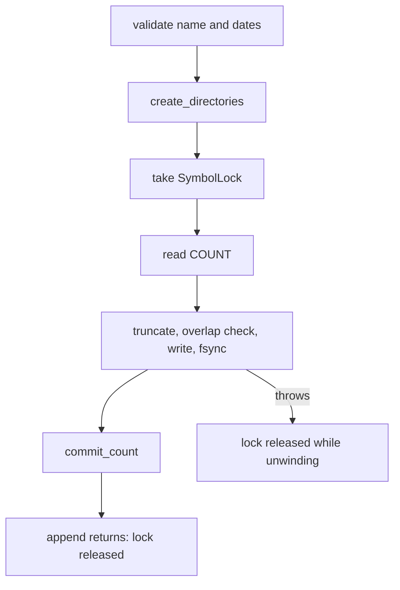

# Phase D tutorial: one writer at a time per symbol

> Drafted with AI assistance (Claude). Every snippet below was compiled and run against the Phase D tests, including ten repeated runs, before this was written.

Back to the checklist: [todo.md](todo.md). Previous phases: [phase_a_readme.md](phase_a_readme.md), [phase_b_readme.md](phase_b_readme.md), [phase_c_readme.md](phase_c_readme.md). Extra reading: [code_snippets.md](code_snippets.md), "Phase D".

> [!info] Diagrams
> The `tikz` blocks need the TikZJax plugin in Obsidian, or Markdown Preview Enhanced in VS Code. Math and `mermaid` need nothing extra.

**Order to follow:** D1 (the lock), D2 (its destructor), then add it to `append`.

---

## 0. The loop for every step

All Phase D tests are already unhidden.

```sh
cmake --build build -j16 --target score_tests
make test-tag TAG="<filter>"
```

| Step | Filter | File |
|---|---|---|
| D1, D2 | `[symbol_dir][D]` | `test_db_symbol_dir.cpp` (2 tests) |
| the lock in `append` | `[columnstore][D]` | `test_db_column_store.cpp` (3 tests) |
| whole phase | `[D]` | both |

The Phase D tests start child processes, so run the whole phase several times to catch rare failures:

```sh
for i in $(seq 1 10); do ./build/tests/cpp/score_tests "[D]" > /dev/null || echo "run $i failed"; done
```

---

## 1. The problem

Phase B made one append safe against a **crash**. Phase D makes it safe against a **second writer** appending to the same symbol at the same time.

`append` reads `COUNT`, writes new rows after it, and commits a new `COUNT`. If two writers do that at once, both can read the same old count:

$$C_A = C_B = n$$

Both then write their rows starting at row $n$, on top of each other, and both commit. With $k$ bars each, the symbol should now hold $n + 2k$ rows, but at best it holds $n + k$, and the rows may be a mix of both writers.

```tikz
\begin{document}
\begin{tikzpicture}[x=1cm,y=1cm]
\node[anchor=east] at (-0.3,1.4) {writer A};
\node[anchor=east] at (-0.3,0) {writer B};
\node[draw,fill=yellow!30,minimum width=2cm,minimum height=0.7cm] at (1,1.4) {\scriptsize read COUNT = n};
\node[draw,fill=blue!15,minimum width=3cm,minimum height=0.7cm] at (3.5,1.4) {\scriptsize write rows at n};
\node[draw,fill=green!20,minimum width=1.6cm,minimum height=0.7cm] at (5.8,1.4) {\scriptsize commit};
\node[draw,fill=yellow!30,minimum width=2cm,minimum height=0.7cm] at (1.5,0) {\scriptsize read COUNT = n};
\node[draw,fill=blue!15,minimum width=3cm,minimum height=0.7cm] at (4.0,0) {\scriptsize write rows at n};
\node[draw,fill=green!20,minimum width=1.6cm,minimum height=0.7cm] at (6.3,0) {\scriptsize commit};
\draw[red,thick,dashed] (0.7,-0.6) rectangle (5.4,2.0);
\node[red] at (3.0,2.3) {\small both read the same n, then overwrite each other};
\end{tikzpicture}
\end{document}
```

The fix is a lock per symbol. For two writers $A$ and $B$ on the same symbol, with critical sections $[l_A, u_A]$ and $[l_B, u_B]$ (from taking the lock to releasing it):

$$[l_A,\, u_A] \;\cap\; [l_B,\, u_B] \;=\; \varnothing$$

Everything that depends on `COUNT` happens inside the critical section: reading it, truncating, the overlap check, writing and committing.

```tikz
\begin{document}
\begin{tikzpicture}[x=1cm,y=1cm]
\node[anchor=east] at (-0.3,1.4) {writer A};
\node[anchor=east] at (-0.3,0) {writer B};
\node[draw,fill=red!15,minimum width=0.9cm,minimum height=0.7cm] at (0.45,1.4) {\scriptsize lock};
\node[draw,fill=blue!15,minimum width=4cm,minimum height=0.7cm] at (3.0,1.4) {\scriptsize read, write, commit};
\node[draw,dashed,fill=gray!20,minimum width=5.4cm,minimum height=0.7cm] at (2.9,0) {\scriptsize B waits for the lock};
\node[draw,fill=red!15,minimum width=0.9cm,minimum height=0.7cm] at (6.05,0) {\scriptsize lock};
\node[draw,fill=blue!15,minimum width=4cm,minimum height=0.7cm] at (8.5,0) {\scriptsize read, write, commit};
\draw[->,thick] (5.0,1.05) -- (5.6,0.4);
\node at (4.4,-0.9) {\small A releases the lock, B proceeds and sees A's rows};
\end{tikzpicture}
\end{document}
```

Writers on **different** symbols hold different locks, so they still run in parallel.

---

## 2. What `flock` is

`flock` puts an **advisory** lock on an open file. Advisory means it only stops other code that also asks for the lock, which is all the store needs. We lock a small empty file, `LOCK`, inside each symbol directory.

| Fact | Consequence |
|---|---|
| the lock belongs to the **open file**, not the process or thread | two separate `open` calls on the same path exclude each other, even in one process, so one `SymbolLock` per append works for threads and processes alike |
| closing the descriptor releases the lock | an RAII class that owns the descriptor releases the lock for free, even when an exception is thrown |
| a process that dies releases its lock | a crashed writer cannot block the store forever; no stale lock file to delete |
| a `dup`ed or `fork`-inherited descriptor shares the lock | take the lock **after** forking, never before |
| `flock` can be interrupted by a signal | the call returns `-1` with `errno == EINTR` and must be retried |
| `flock` over NFS is unreliable | v1 assumes a local disk |

> [!warning] Never delete `LOCK`
> Deleting the file while someone holds it lets a new writer create a fresh `LOCK` and lock that instead, so two writers get in at once.

---

## 3. The helpers

All live in the anonymous namespace in `src/db/symbol_dir.cpp`. The first two were written for Phase B and are reused.

| Helper | What it hides |
|---|---|
| `open_path(path, flags)` | `open(2)` with `O_CLOEXEC`; failure throws `system_error` |
| `throw_errno(what)` | the repeated `std::system_error(errno, generic_category(), ...)` line |
| `retry_on_eintr(system_call)` | the retry loop for a call that fails with `EINTR`; takes a lambda |
| `flock_exclusive(fd)` | blocks until the descriptor holds an exclusive lock; throws on any other error |

```cpp
template <typename SystemCall>
int retry_on_eintr(SystemCall system_call) {
    int result = 0;
    do {
        result = system_call();
    } while(result == -1 && errno == EINTR);
    return result;
}

void flock_exclusive(int fd) {
    const int result = retry_on_eintr([fd] { return ::flock(fd, LOCK_EX); });
    if(result != 0) { throw_errno("flock"); }
}
```

The lambda keeps the retry logic in one place, so the next system call that needs retrying (a `read`, a `write`) can reuse it.

---

## 4. D1: the `SymbolLock` constructor

Open `LOCK` (creating it if it is new), then block until the lock is ours:

```cpp
SymbolLock::SymbolLock(const std::filesystem::path& symbol_dir) {
    fd_ = open_path(symbol_dir / kLockFileName, O_RDWR | O_CREAT);
    flock_exclusive(fd_.get());
}
```

If `flock_exclusive` throws, the constructor does not finish, but `fd_` is already a fully built member, so its destructor still runs and closes the descriptor. Nothing leaks.

---

## 5. D2: the destructor

There is nothing to write. `fd_` is a `UniqueFd`, which closes the descriptor when it is destroyed, and closing the descriptor releases the lock:

```cpp
SymbolLock::~SymbolLock() = default;  // the UniqueFd member closes the descriptor, which releases the flock
```

Run: `make test-tag TAG="[symbol_dir][D]"`. The test "excludes another process" forks a child that takes the lock; the parent then proves it cannot get it.

---

## 6. The lock in `append`

One line, placed after the directory exists and before anything reads `COUNT`:

```cpp
std::filesystem::create_directories(symbol_path);

const SymbolLock lock(symbol_path);  // from here on, no other writer can touch this symbol
const std::size_t committed_rows = read_committed_count(symbol_path);
// ... truncate, overlap check, write, commit ...
```

Why it goes exactly there:

| Placement | Reason |
|---|---|
| **after** `create_directories` | the `LOCK` file lives inside the directory, which must exist |
| **before** `read_committed_count` | "read the count, then lock" lets two writers read the same count; the read must be inside the lock |
| **after** `to_columns` | validating the bars touches no shared state, so it does not need to hold anyone up |
| a local object, not a manual unlock | the lock is released when `append` returns **or throws**, so a rejected overlap cannot leave the symbol locked |



> [!note] The "watch it fail" check from the todo
> Before adding the line above, the test "two processes appending the same bars to one symbol" was run three times and **failed all three**. After adding it, ten full runs of `[D]` all passed. That is the evidence the lock, and not luck, makes it work.

---

## 7. The five tests

| Test | What it proves |
|---|---|
| `SymbolLock: released when the object dies` | the lock is held inside the scope and free after it |
| `SymbolLock: excludes another process` | a forked child holding the lock keeps the parent out, and exiting releases it |
| `processes appending different symbols in parallel` | four processes, four symbols, 20 batches each: no interference, every bar present and in order |
| `two processes appending the same bars to one symbol` | exactly one wins and one gets a `DomainError` (overlap), 20 rounds; without the lock both read "no rows yet" |
| `a reader never sees part of an append` | a reader scanning while a writer appends only ever sees whole batches, and committed rows never disappear |

The last one needs no lock on the reader side. Readers take a snapshot of `COUNT` (Phase C), and the commit is an atomic rename (Phase B), so a lock-free read is already consistent.

> [!note] Rules for tests that fork
> The child must leave with `_exit`, never by returning into Catch2, and it must take the lock **after** the fork. `run_in_child` in `tests/cpp/db_test_util.hpp` does the first part for you.

---

## 8. Common mistakes

| Mistake | Why it breaks |
|---|---|
| reading `COUNT` before taking the lock | two writers read the same count and overwrite each other |
| taking the lock before `create_directories` | `open` of `LOCK` fails because the directory does not exist yet |
| deleting `LOCK` to "clean up" | a new writer locks a new file while the old holder is still working |
| forgetting to retry on `EINTR` | a signal turns into a spurious `flock` error |
| holding the lock past the commit | blocks other writers for no reason; a scope-bound object avoids this |
| locking before `fork` in a test | parent and child share one lock instead of excluding each other |

---

## 9. Notes: what was done and how

**Result:** `make test-tag TAG="[D]"` passes (5 cases, 315 assertions) and stayed green across 10 repeated runs. Everything else is still green: Phase A (19 cases), Phase B (19), Phase C (18), `[risk]` (13), `[stats]` (11), `[metrics]` (5), `ctest` (94 of 94) and the Python tests (30 passed, 1 skipped for the missing `psycopg`). D1, D2 and the `append` item are ticked in [todo.md](todo.md).

| Step | What was written | How |
|---|---|---|
| D1 | `SymbolLock::SymbolLock` | `open_path` on `LOCK`, then `flock_exclusive` |
| D2 | `SymbolLock::~SymbolLock` | `= default`; the `UniqueFd` member releases the lock |
| append | `ColumnStoreV1::append` | `const SymbolLock lock(symbol_path);` before reading `COUNT` |

**Helpers added:** `retry_on_eintr` and `flock_exclusive` in `symbol_dir.cpp`, plus `<sys/file.h>` for `flock`.

**Design choices**
- **RAII for the lock**, so every exit path, including a thrown `DomainError`, releases it.
- **One lock file per symbol**, so writers on different symbols never wait for each other.
- **No lock on the read path.** Readers are consistent through `COUNT` plus the atomic rename, so they never block writers or each other.
- **No timeout.** A writer waits as long as it takes. The kernel releases the lock if a holder dies, so waiting cannot last forever.

**Known limits**
- **Local disks only.** `flock` over NFS is unreliable.
- **Writers queue.** Two writers on one symbol run one after the other; that is the point, but a very long append delays the next.
- **No fairness guarantee.** The kernel decides which waiting writer gets the lock next.

---

## 10. In plain words

**The problem.** Imagine a shared ledger and two clerks who each want to add new lines at the bottom. Each clerk looks at the last line, then writes the next lines underneath. If both look at the same moment, both see the same last line, and they write on top of each other. The ledger ends up garbled.

**The fix.** Give each ledger one **key**, and the rule that you must hold the key to write. Clerk A takes the key, writes, and puts it back. Clerk B waits until it is back, then sees A's lines and writes below them. Different ledgers have different keys, so clerks on different ledgers never wait for each other.

**What `flock` is.** It is the computer's built-in key system. The key is attached to the file called `LOCK` in each symbol's folder.

**Why it is safe if a program crashes.** The computer takes the key back automatically when a program dies. Nobody is ever locked out forever, and there is nothing to clean up by hand.

**Why the code is short.** The key is wrapped in a small object (`SymbolLock`). Creating it picks up the key and destroying it puts the key back, even if something goes wrong halfway. In `append` that is one line, and the key is released on its own when the function ends.

**Why readers do not need the key.** Readers only read lines that are fully finished. Phase B made "finished" an all-or-nothing switch, so a reader can never see half of what a writer is doing.

**How we know it works.** Without the key, the test with two writers failed three times out of three. With the key it passed every time, including ten repeated runs of the whole phase.

---

## 11. Finish line

```sh
make test-tag TAG="[D]"
for i in $(seq 1 10); do ./build/tests/cpp/score_tests "[D]" > /dev/null || echo "run $i failed"; done
```

All 5 Phase D tests should pass every time. Then Phase E (Python and NumPy) is next.
